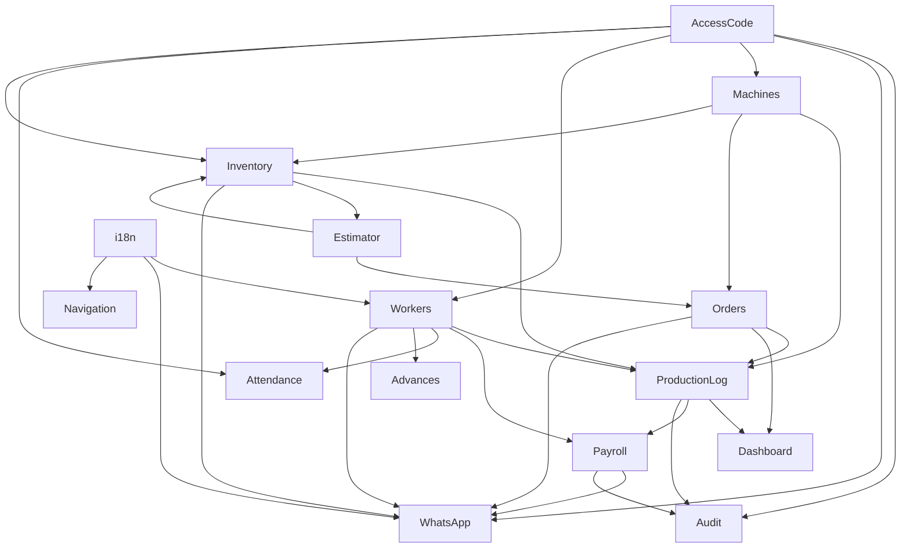

# Vastra — Comprehensive Feature Analysis (Part 2 of 2)

> **Coverage**: Production Logging · Payroll & Advances · Access Code Guard · Audit Trail · Safety Incidents · Estimator · WhatsApp Pipeline · i18n & Transliteration
>
> **Part 1 covers**: Owner Dashboard · Machine Management · Inventory & Yarn · Orders · Worker Management

---

## Feature 6: Production Logging (`/supervisor/production`)

### What It Does
Production Logging is the central data-entry point that feeds everything else in the platform. Supervisors log how many meters each worker produced on each machine during a shift. Every entry is immutable once saved, rate-snapshotted, and immediately broadcast to the owner's dashboard.

### Who Uses It
**Supervisor** (primary). Owner can view logs but does not create them.

### Inputs

| Field | Source | Notes |
|---|---|---|
| Machine | Select from active machines | Inactive machines are excluded from list |
| Worker | Auto-resolved from machine assignment | Pull from `machine_assignments` for current shift |
| Meters Produced | Number input | Decimal accepted; validated positive |
| Shift | Auto-detected | Derived from `getSuratNow()`: 07:00–19:00 = Day; 19:00–07:00 = Night |
| Date | Auto-set to Surat Today | Cannot be changed without access code |

### How `worker_rate_snapshot` Works at Save Time
```
Supervisor taps "Save"
  → Server Action fires
    → Fetches yarn_batches.quality_id for the machine's current batch
      → Fetches qualities.default_worker_rate_per_m for that quality
        → Inserts production_logs with worker_rate_snapshot = that rate
```
**This rate is frozen forever on this row.** Future quality edits do not touch historical snapshots.

### Shift Auto-Detection
`lib/time.ts` determines the active shift from the Surat local clock:
```
getSuratNow() → Asia/Kolkata
07:00 ≤ time < 19:00 → "day"
otherwise             → "night"
```
Shift is stored on the log entry and displayed on reports.

### Entry Lock Rules (Read-Only After Save)
Once a production log is saved, it is **read-only** in the standard UI. To edit:
- Within 15 minutes of creation: Owner can edit without code (not exposed in current UI)
- After 15 minutes / already saved: Requires a valid **Access Code** from the owner

### Backdating Production (Past Date Entry)
If a supervisor needs to log for a previous date:
- A separate "Past Entry" UI path requires an Access Code
- On validation the server action uses `service_role` client to bypass the RLS date-lock
- `set_actor_for_audit()` is called so the audit trigger records the true actor despite the elevated client

### Data Written to DB
```sql
INSERT INTO production_logs (
  org_id,           -- from JWT
  machine_id,
  worker_id,
  yarn_batch_id,    -- from machine's current batch
  current_order_id, -- from machine's current order
  meters,
  date,             -- Surat today string (YYYY-MM-DD)
  shift,            -- 'day' | 'night'
  worker_rate_snapshot,  -- frozen from quality at save time
  updated_by        -- user.id from JWT
)
```

### Real-Time Broadcast
```
INSERT committed
  → Supabase Realtime broadcasts on channel: `org-{org_id}`
    → Owner's dashboard receives WS message
      → KPI strip re-queries and repaints (meters, wages, efficiency)
      → Order card progress bar updates
```
No polling. No manual refresh. The owner sees the update within ~1 second.

### Audit Trigger
Every INSERT and UPDATE on `production_logs` fires a PostgreSQL trigger that writes to `audit_log`:
- `event_type`: `INSERT` or `UPDATE`
- `table_name`: `production_logs`
- `old_data`: `NULL` on insert; full JSONB snapshot on update
- `new_data`: Full JSONB of the new row
- `actor_id`: `auth.uid()` or the value set by `set_actor_for_audit()`
- `access_code_used`: `true` if a code was consumed for this operation (set via PostgreSQL session variable `app.access_code_used`)

### UX Workflow
1. Supervisor opens `/supervisor/production`
2. Sees a list of active machines with their current beam and assigned worker (auto-loaded for current shift)
3. Types meters into the input field for each machine
4. Taps "Save Entry" — entry is written, rate snapshot captured, Realtime fires
5. The saved entry becomes a read-only row below the input form with meters + rate displayed
6. Any attempt to edit that row shows a lock icon → leads to Access Code dialog

### Connections to Other Features
| Feature | How |
|---|---|
| **Machine Management** | Machine + worker assignment determines who/what is logged |
| **Inventory** | `yarn_batch_id` links log to batch; meters accumulate toward actual yield |
| **Orders** | `current_order_id` links log to order; meters count toward order progress |
| **Owner Dashboard** | Real-time via Supabase Realtime WebSocket |
| **Payroll** | `worker_rate_snapshot` on every log is the source of payroll gross pay |
| **Access Code Guard** | Editing locked entries / backdating requires a valid code |
| **Audit Trail** | Every insert/update triggers an audit snapshot |

---

## Feature 7: Attendance (`/supervisor/attendance`)

### What It Does
Daily attendance tracking for **Fixed (salaried) workers**. Piece-rate workers are implicitly "present" when they have production logs. Fixed workers need explicit present/absent recording since their salary is pro-rated by attendance.

### Who Uses It
- **Supervisor**: Mark today's attendance (no code required)
- **Owner or Supervisor**: Backdate attendance for past dates (requires Access Code)

### Inputs
- Fixed worker list (auto-loaded from `fixed_workers` where `is_active = true`)
- Present/Absent toggle per worker
- Date: defaults to Surat Today; past-date entry requires code

### Save Today's Attendance
Server action: standard `supabase.from('attendance').upsert()` on `(fixed_worker_id, date)` conflict key.
- `present: true` or `present: false`
- `marked_by: user.id` — stored for accountability

### Save Past Attendance (`savePastAttendance`)
**Requires Access Code**:
1. Validates `SavePastAttendanceSchema` (Zod) — date format, record structure, code format
2. Calls `validateAndConsumeAccessCode()` with Upstash rate limiting
3. On valid code: uses `service_role` client to bypass the RLS date-guard
4. `set_actor_for_audit()` called before upsert so audit trigger captures the real user
5. Upserts all attendance records for that date

### Impact on Payroll
```
Days Present = COUNT(attendance rows WHERE present = true AND date BETWEEN cycle_start AND cycle_end)
Pro-Rated Salary = (monthly_salary / total_days_in_cycle) × days_present
```

### Connections to Other Features
| Feature | How |
|---|---|
| **Fixed Workers** | List of workers to mark comes from `fixed_workers` |
| **Payroll** | Attendance days directly drive salaried worker's gross pay |
| **Access Code Guard** | Past-date edits require valid code |
| **Audit Trail** | Attendance changes trigger audit entries |

---

## Feature 8: Payroll & Advances (`/owner/payroll`, `/owner/advances`)

### What It Does
The payroll module computes monthly gross pay from production logs (for piece-rate workers) or attendance (for fixed workers), deducts outstanding advances under Indian labour law constraints, and produces locked settlement records and payslips.

### 8A: Advances (Upaad) System

#### Who Uses It
- **Owner**: Records advances, views balance history, manages WhatsApp receipt delivery
- **Supervisor**: Can view worker debt (`getWorkerDebt()`); cannot create advances directly

#### Recording an Advance
**Inputs**: Worker (select), Amount (₹), Reason (medical / school fees / personal / other), Date  
**Server Action**: `supabase.from('worker_advances').insert()` with `status: 'pending'`

#### Advance States
```
pending     →  [settle_worker_payroll()]  →  deducted      (in full or partial)
pending     →  [partial settlement]       →  split:
                                              • original → deducted (partial amount)
                                              • new row  → pending  (remainder — carry-forward)
```

#### Worker Debt Check
`getWorkerDebt(workerId, workerType)` — sums all `pending` advances for this worker.  
Called when: supervisor views worker card, payroll page loads worker row.

#### WhatsApp Advance Receipt
When `send-advance-receipt` is triggered after recording an advance:
- Edge Function reads advance details
- Sends Interakt template message to worker's `whatsapp_number`
- Message in worker's preferred `whatsapp_language` (en/hi/gu)
- Logged in `whatsapp_delivery_log`

### 8B: Payroll Settlement Engine

#### Gross Pay Calculation
**Piece-Rate Workers**:
```
Gross Pay = SUM(production_logs.meters × production_logs.worker_rate_snapshot)
            WHERE worker_id = X AND date BETWEEN cycle_start AND cycle_end
```
Note: Uses `worker_rate_snapshot` — never the live quality rate. Historical integrity preserved.

**Fixed Workers**:
```
Gross Pay = (monthly_salary / total_cycle_days) × days_present
```

#### Settle Worker Payroll — Full Flow (`settle_worker_payroll` RPC)
Called as a PostgreSQL function in a single transaction:

1. **Sum pending advances** for this worker
2. **Compute deduction cap**:
   - Normal settlement: cap = 50% of gross (Indian Code on Wages, 2019)
   - Final settlement (termination): cap = 100% of gross
3. **Actual deduction** = `MIN(total_advances, cap)`
4. **Oldest-first advance deduction** loop:
   - If advance.amount ≤ remaining budget → mark `deducted`, link `settlement_id`
   - If advance.amount > remaining budget → split: original becomes `deducted` for partial, new row inserted as `pending` for remainder
5. **Insert/upsert `payroll_settlements` snapshot** with:
   - `gross_pay`, `advance_deducted`, `net_payout`, `carried_forward_debt`
   - `compliance_flag = true` if 50% cap was triggered
   - `is_final_settlement` flag
6. **Compute carry-forward debt** (remaining pending advances after settlement)
7. **Returns** JSONB with all values to the caller

#### The 50% Legal Cap — UX Display
When `compliance_flag = true` on a settlement:
- UI shows an amber badge: "50% Cap Applied"
- Carry-forward debt displayed below: "₹X,XXX carried to next month"
- Owner cannot override the cap in UI (it's enforced at the RPC level)

#### Payroll Settlement Card UI
```
┌─────────────────────────────────────────────┐
│ Ramesh Patel        April 2026              │
│ ─────────────────────────────────────────── │
│ Gross Earnings:        ₹4,200.00            │
│ Advances Deducted:    −₹2,100.00  [Cap 50%] │
│ Net Payout:            ₹2,100.00            │
│ Carry-Forward Debt:    ₹  800.00            │
│                  [Send Payslip ▸] [Settle]  │
└─────────────────────────────────────────────┘
```

#### Unsettle Payroll (`unsettle_worker_payroll`)
Owner can reverse a settlement (e.g., error in gross pay):
1. Finds settlement record by `(org_id, worker_id, month)`
2. Restores all linked advances to `pending` (removes `deducted_at`, `settlement_id`)
3. Deletes the `payroll_settlements` row
4. Production logs unlock for that period

#### Custom Pay Cycle
`payroll_configs` table stores `cycle_start_day` per org (1–28). If an org starts payroll on the 15th:
```
Cycle: 15 Mar → 14 Apr
```
All date range queries for production logs and attendance respect this config.

#### Payslip Generation & WhatsApp Delivery
After settlement:
- Owner clicks "Send Payslip" on worker card
- `send-payslip` Edge Function called with `settlement_id`
- Generates formatted message via Interakt template:
  ```
  PAYROLL SLIP — [Factory Name]
  Worker: Ramesh Patel
  Month: April 2026
  Gross: ₹4,200.00 | Deductions: ₹2,100.00 | Net: ₹2,100.00
  Carry-Forward: ₹800.00
  ```
- Delivered to worker's WhatsApp in their preferred language
- Logged in `whatsapp_delivery_log` with `status` tracking

### Connections to Other Features
| Feature | How |
|---|---|
| **Production Logging** | `worker_rate_snapshot` on every log is the source of gross pay |
| **Attendance** | Fixed worker gross pay is attendance-weighted |
| **Workers** | Settlement linked to `meter_worker_id` or `fixed_worker_id` |
| **WhatsApp** | Payslip and advance receipt sent via Interakt Edge Functions |
| **Audit Trail** | `payroll_settlements` INSERT/UPDATE triggers audit |
| **Access Code** | Not required for settlement itself; required for editing locked production logs that feed payroll |

---

## Feature 9: Access Code Guard

### What It Does
The Access Code system is the platform's **digital approval mechanism**. Any action that carries significant financial, operational, or accountability risk cannot be performed by a supervisor alone — it requires a single-use, time-limited code generated and delivered to the owner.

### Who Uses It
- **Owner**: Generates the code (from Settings or via the code generator UI)
- **Supervisor**: Requests a code (triggers WhatsApp delivery to owner) and enters it to proceed

### Code Generation Flow (Owner Initiates)
`generateAccessCode()` server action:
1. `crypto.randomBytes(3).toString('hex').toUpperCase()` → 6-char alphanumeric code (e.g., `A3F9C2`)
2. SHA-256 hash of the code stored in `organizations.access_code_hash`
3. Expiry: `NOW() + 15 minutes` stored in `organizations.access_code_expires_at`
4. **Fire-and-forget**: `send-access-code` Edge Function called → owner receives code on WhatsApp instantly
5. Code also displayed on screen (plaintext, visible to owner)

### Code Request Flow (Supervisor Initiates)
`requestAccessCode()` supervisor action:
1. Generates code same way as above
2. Fetches requester's profile name
3. Calls `send-access-code` Edge Function with `requested_by: "Supervisor Name"`
4. Owner WhatsApp message reads: *"[Supervisor Name] is requesting an access code. Code: A3F9C2. Expires in 15 minutes."*
5. Returns `{ success: true }` — supervisor sees "Request sent to owner"

### Code Validation & Consumption (`validateAndConsumeAccessCode`)
Every protected server action calls this internal helper:

```
1. Check Upstash Redis lockout: 5 fails = 1-hour hard ban (userId-keyed)
2. Check Upstash sliding window: 5 attempts per 10 min (userId-keyed)
3. Zod validate code format: 6 alphanumeric chars
4. DB fetch: organizations.access_code_hash + access_code_expires_at
5. Check expiry: NOW() > expires_at → reject
6. SHA-256 hash input code
7. crypto.timingSafeEqual() comparison → prevents timing attacks
8. On match: NULL out hash + expiry in DB (single-use consumed)
9. Set PostgreSQL session var: app.access_code_used = 'true'
10. Reset Redis failure counter
```

### Protected Actions Requiring a Code

| Action | Who Requests | Server Action |
|---|---|---|
| Delete a machine | Supervisor | `deleteMachineWithCode()` |
| Delete a piece-rate worker | Supervisor | `deleteWorkerWithCode()` |
| Delete a fixed worker | Owner | `deleteFixedWorkerWithCode()` |
| Backdate attendance | Supervisor/Owner | `savePastAttendance()` |
| Un-consume a yarn batch | Supervisor/Owner | `unconsumeBatchWithCode()` |
| Edit a locked production log | Supervisor | `verifyAccessCode()` + log edit |

### Security Properties
| Property | Mechanism |
|---|---|
| Single-use | Hash + expiry nulled on first valid consumption |
| Time-limited | 15-minute TTL; server-side comparison |
| Timing-safe | `crypto.timingSafeEqual()` — no timing oracle |
| Rate-limited | Upstash Redis: sliding window + hard lockout |
| IDOR-protected | `orgId` always derived from JWT, never from client input |
| Non-repudiable | `app.access_code_used` session var → audit trigger records code usage |
| Remote delivery | WhatsApp — owner doesn't need to be on-site |

### Audit Linkage
When a code is consumed, the PostgreSQL session variable `app.access_code_used = 'true'` is set. The audit trigger on any subsequent DML in the same transaction reads this variable and sets `access_code_used = true` on the `audit_log` row — permanently linking the action to the code approval.

### UX Workflow
```
Supervisor tries to delete Machine 7
  → UI shows: "This action requires owner approval"
  → [Request Code from Owner] button
    → requestAccessCode() fires
      → Owner receives WhatsApp: "Supervisor is requesting a code. Code: B7D2A1"
        → Supervisor is told: "Code sent to owner's WhatsApp"
          → Owner reads code → tells supervisor verbally or via phone
            → Supervisor types code into dialog
              → validateAndConsumeAccessCode() → verified
                → deleteMachineWithCode() proceeds
                  → Machine deleted + audit log written
```

---

## Feature 10: Audit Trail (`/owner/audit`)

### What It Does
The Audit Trail gives the Owner a complete, human-readable history of every consequential action taken in the system — who did what, when, to what record, and whether an access code was used.

### Who Uses It
**Owner only.** Supervisors cannot access the audit log.

### How Data Gets Into the Audit Log
PostgreSQL triggers on these tables fire on `INSERT`, `UPDATE`, and `DELETE`:
- `workers`
- `fixed_workers`
- `machines`
- `production_logs`
- `yarn_batches`
- `qualities`
- `payroll_settlements`
- `incidents`
- `attendance`

Each trigger writes to `audit_log`:
```sql
{
  id:               UUID
  org_id:           UUID
  actor_id:         auth.uid() OR set_actor_for_audit() value
  event_type:       'INSERT' | 'UPDATE' | 'DELETE'
  table_name:       'machines' (etc.)
  record_id:        primary key of the changed row
  old_data:         JSONB snapshot of row BEFORE change (NULL on INSERT)
  new_data:         JSONB snapshot of row AFTER change (NULL on DELETE)
  access_code_used: BOOLEAN (from app.access_code_used session var)
  created_at:       TIMESTAMPTZ
}
```

### Human-Readable Diff Display
The UI parses `old_data` and `new_data` to show:
- **Field-by-field changes** instead of raw JSON
- Example: Instead of `{"rate": 12.0}` → `{"rate": 14.0}` the UI renders:
  > *"Changed default_worker_rate_per_m from ₹12.00 to ₹14.00"*
- For money fields: formatted as ₹
- For status fields: shows badge-style labels (Active → Inactive)
- For deletions: shows a summary of the deleted record's key fields

### Filtering & Navigation
Owner can filter the audit log by:
- **Event Category**: Production, Inventory, Workers, Machines, Payroll, Incidents
- **Date Range**: From/To date picker
- **Access Code Events**: Toggle to show only actions that required owner approval

### Category Colour Coding
| Category | Colour | Tables Covered |
|---|---|---|
| Production | Blue | `production_logs` |
| Inventory | Green | `yarn_batches`, `qualities` |
| Workers | Purple | `workers`, `fixed_workers` |
| Machines | Orange | `machines` |
| Payroll | Gold | `payroll_settlements` |

### Retention & Compliance
- Designed for **3-year retention** under Indian Labour laws
- No delete policy on `audit_log` table for authenticated users
- `service_role` can purge if needed (admin operation only)
- Data Minimization: only primary key + JSONB diff stored — no PII beyond what's on the source record

### Connections to Other Features
| Feature | How |
|---|---|
| **Access Code Guard** | `access_code_used` flag on entries requiring codes — visible in audit |
| **Machine Management** | Every machine change logged |
| **Production Logging** | Every log create/edit logged with before/after snapshot |
| **Payroll** | Settlements logged with full snapshot |
| **Workers** | Add/delete/edit logged |

---

## Feature 12: Vastra Estimator (`/owner/estimator`)

### What It Does
A professional pre-production costing engine for negotiating order prices. The Owner inputs fabric technical specs, yarn costs, job-work charges, and factory overheads — the estimator computes the exact landed cost per meter, shows profit simulation, and can convert the quote into a live Production Order.

### Who Uses It
**Owner only.** Used before accepting a new party order to determine minimum viable price.

### Inputs

#### Technical Specs
| Input | Unit | Purpose |
|---|---|---|
| PPI (Picks per Inch) | count | Determines loom speed and daily production |
| Yarn Denier | number | Yarn thickness; affects GSM calculation |
| GSM | g/m² | Grams per square meter of the target fabric |

#### Cost Inputs
| Input | Unit | Purpose |
|---|---|---|
| Yarn Rate | ₹/kg | Raw material cost |
| Job-Work Charges | Array of `{name, rate, shrinkage%}` | Dyeing, weaving labour, finishing |
| Electricity Rate | ₹/kWh | Power cost per unit |
| Factory Rent | ₹/day | Fixed overhead |
| Admin Overhead | ₹/day | Salaries, admin costs |

#### Assumptions
| Input | Default | Purpose |
|---|---|---|
| Machine Efficiency | 0.85 | % of theoretical max production achieved |
| Standard Wastage | 5% | Yarn consumption overhead |
| GST Rate | 5% | Applied to final landed cost |
| GST Inclusive? | Toggle | Whether sale price includes GST |

### The Surat Landed Cost Formula (`lib/estimator.ts`)

```
Step 1: Grey Cost
  greyCostPerMeter = (GSM × yarn_rate_per_kg / 1000) × (1 + wastage%)

Step 2: Job-Work with Shrinkage
  directCost = (greyCost + Σ job_work_rates) / (1 − Σ shrinkage_factors)

Step 3: Overhead Allocation
  daily_production = (RPM / PPI) × 60min × 24h × efficiency × conversion_factor
  → RPM = 600 (standard water-jet loom)
  powerCost = (2.5kW × 24h × electricity_rate) / daily_production
  overheadCost = ((rent + admin) / machine_count) / daily_production

Step 4: Pure Landed Cost
  pureLandedCost = directCost + powerCost + overheadCost

Step 5: GST
  finalLandedCost = pureLandedCost × (1 + GST%) if not inclusive
                  = pureLandedCost if inclusive
```

### Output Display
The estimator shows a **live cost breakdown card** that updates as inputs change (React state, no server round-trip for calculation):

```
┌──────────────────────────────────────────┐
│ Cost Breakdown (per meter)               │
│ Grey (Yarn) Cost:      ₹ 8.50           │
│ Job-Work Cost:         ₹ 4.20           │
│ Power Cost:            ₹ 0.60           │
│ Overhead Cost:         ₹ 0.35           │
│ ─────────────────────────────────────── │
│ Pure Landed Cost:      ₹13.65           │
│ GST (5%):             +₹ 0.68           │
│ Final Landed Cost:     ₹14.33           │
│                                         │
│ ── Profit Simulator ─────────────────── │
│ Margin: [════●════] 15%                 │
│ Sale Price per meter:  ₹16.48           │
│ Per-meter Profit:      ₹ 2.15           │
│ Order Profit (1000m):  ₹2,150.00        │
└──────────────────────────────────────────┘
```

### Profit Simulation Slider
Owner drags the margin % slider (0–60%) and sees:
- Sale price per meter recalculated in real-time
- Per-meter profit in ₹
- Total order profit for the planned order quantity

### Stress Test Scenarios
`runStressTest()` from `lib/estimator.ts` computes three scenarios automatically:

| Scenario | Change | Output |
|---|---|---|
| Yarn Price Hike | +5% yarn rate | New landed cost |
| Efficiency Drop | −15% machine efficiency | New landed cost |
| PPI Increase | +5 picks per inch | New landed cost |

Displayed as a comparison table so the owner understands pricing risk.

### Convert to Order Flow
When the quote is finalized:
1. Owner clicks "Convert to Order"
2. System auto-creates a new **Quality** record with:
   - Name from the estimator's fabric spec
   - Target yield derived from GSM + denier
   - Sale price from the estimated final landed cost
   - Worker rate from the job-work charges
3. Opens the Order creation form pre-filled with:
   - `quality_id` = newly created quality
   - Party name (if entered in estimator)
   - Target meters = order quantity from estimator
4. Owner confirms → Order goes live on the dashboard

### Connections to Other Features
| Feature | How |
|---|---|
| **Inventory** | Creates a new Quality definition on "Convert to Order" |
| **Orders** | Convert flow creates a live Production Order |
| **Owner Dashboard** | Converted order immediately appears on analytics dashboard |

---

## Feature 13: WhatsApp Notification Pipeline

### What It Does
A complete push notification system delivering factory intelligence, financial documents, and security codes directly to WhatsApp — powered by **Interakt** (Meta-approved BSP) via 10 Supabase Edge Functions.

### Opt-In & Number Management
**Owner opt-in** (via `/owner/settings`):
- `saveWhatsAppPreferences(phone, optedIn)` server action
- Validates: 10-digit Indian mobile, strips non-digits
- Sets `whatsapp_opted_in = true`, `whatsapp_number = phone`, `whatsapp_opted_in_at = now()` on `profiles`
- Owner can opt out: `whatsapp_opted_in = false` (number retained, opt-in cleared)

**Worker number setup** (owner action in payroll/worker screens):
- `saveWorkerWhatsApp(workerId, workerType, phone, language, consentGiven)` server action
- Hard blocks if `consentGiven = false` (DPDP Act compliance)
- Stores on `workers` or `fixed_workers` table

### Edge Function Catalog (10 Functions)

#### 1. `send-daily-brief`
- **Trigger**: `pg_cron` at 14:30 UTC (20:00 IST) via `pg_net.http_post`
- **Logic**: Fetches all opted-in owners → for each, calls `get_daily_brief_stats(org_id, today)` RPC
- **Message content**: Total meters today · Active orders · Avg efficiency % · Estimated loss ₹ · Piece-rate wages ₹
- **Recipient**: Owner

#### 2. `send-access-code`
- **Trigger**: `generateAccessCode()` or `requestAccessCode()` server action (fire-and-forget)
- **Payload**: `{ org_id, code, expires_at, requested_by? }`
- **Message**: "Your Vastra access code is: [CODE]. Valid for 15 minutes. Requested by: [Supervisor Name]"
- **Recipient**: Owner

#### 3. `send-payslip`
- **Trigger**: Owner clicks "Send Payslip" after settling a worker's payroll
- **Payload**: `settlement_id` → function fetches full settlement details
- **Message**: Payslip with gross, deductions, net payout, carry-forward debt
- **Recipient**: Worker (in their `whatsapp_language`)

#### 4. `send-advance-receipt`
- **Trigger**: Advance recorded for a worker
- **Message**: "Advance of ₹X received on [Date]. Reason: [Reason]."
- **Recipient**: Worker (in their `whatsapp_language`)

#### 5. `send-yield-alert`
- **Trigger**: `closeYarnBatch()` server action when efficiency variance < −5%
- **Payload**: `{ org_id, batch_id }`
- **Message**: Batch name · Quality · Efficiency % · Estimated loss ₹
- **Cooldown**: Keyed on `batch_id` — fires once per batch close (no repeat spam)
- **Recipient**: Owner

#### 6. `send-deadline-alert`
- **Trigger**: Automated check when Pace Index < threshold for an order
- **Message**: Order name · Party · Deadline · Current pace vs required pace
- **Cooldown**: 24-hour TTL per `order_id` in `whatsapp_cooldowns`
- **Recipient**: Owner

#### 7. `monthly-brief`
- **Trigger**: End-of-month scheduled (pg_cron)
- **Message**: Month totals for meters, wages, active orders, efficiency
- **Recipient**: Owner

#### 8. `daily-brief` (older variant, deprecated in favour of `send-daily-brief`)
- Retained for backward compatibility

#### 9. `whatsapp-summary`
- General WhatsApp summary utility used internally by other functions

### Delivery Audit Log
Every outbound message creates a row in `whatsapp_delivery_log`:
```sql
{
  org_id, owner_profile_id (nullable), recipient_phone,
  sent_at, template_name, notification_type,
  status: 'sent' | 'delivered' | 'read' | 'failed',
  interakt_callback_data,   -- for webhook tracing
  error_message,
  payload_snapshot          -- full Interakt payload for debugging
}
```
- Owners can view their org's delivery log (RLS: owner reads own org only)
- Only `service_role` can write (Edge Functions bypass RLS)

### Cooldown System
`whatsapp_cooldowns` table prevents alert spam:
- Composite PK: `(org_id, alert_type, ref_id)` — deduplication is a single upsert
- `yield_alert`: ref_id = batch_id; fires once per batch close
- `deadline_risk`: ref_id = order_id; 24h TTL checked in Edge Function

### The pg_cron Daily Brief (SQL-Native Trigger)
```sql
-- Stored in migration 20260401030000_pg_cron_schedule.sql
SELECT cron.schedule(
  'vastra-daily-brief',
  '30 14 * * *',   -- 14:30 UTC = 20:00 IST
  $$ SELECT net.http_post(
       url := supabase_url || '/functions/v1/send-daily-brief',
       headers := jsonb_build_object('Authorization', 'Bearer ' || service_role_key),
       body := '{}'
     ) $$
);
```
No external scheduler — the database drives its own notifications.

### Connections to Other Features
| Feature | How |
|---|---|
| **Access Code Guard** | `send-access-code` triggered by both owner and supervisor code flows |
| **Inventory** | `send-yield-alert` triggered on batch close with leakage |
| **Orders** | `send-deadline-alert` triggered on Pace Index risk |
| **Payroll** | `send-payslip` and `send-advance-receipt` triggered by payroll actions |
| **Owner Settings** | Opt-in managed via `saveWhatsAppPreferences()` |

---

## Feature 14: i18n & Transliteration

### What It Does
Vastra is fully multilingual (English, Hindi, Gujarati) with phonetic transliteration for worker names — ensuring that workers see their own names correctly in their native script without requiring manual dual entry.

### i18n System

#### Supported Locales
- `en` — English (default)
- `hi` — Hindi (Devanagari script)
- `gu` — Gujarati script

#### Architecture
- All UI strings stored in locale JSON files under `lib/i18n/`
- Keys are **lowercase, quoted** strings (e.g. `"machines"`, `"production log"`, `"attendance"`)
- `OwnerSidebar.tsx` and `SupervisorSidebar.tsx` lookup navigation labels by lowercase key
- Language selection stored in user's session/preference

#### Standardized Key Schema
All navigation keys and UI strings match exactly between `en.json`, `hi.json`, and `gu.json`. Historical bug: duplicate keys and uppercase mismatches were causing raw key strings to display — now fixed by quoting all keys.

### Phonetic Transliteration (`lib/transliterate.ts`)

#### What It Solves
Worker names are entered and stored in English (e.g., `"Ramesh Patel"`). Supervisors and workers on the floor read Gujarati or Hindi. Without transliteration, workers see their names in English-script which they may not be able to read.

#### How It Works
A custom phonetic mapping engine (no external API, no extra DB columns):
1. Tokenizes the English name into syllables
2. Maps each syllable to its Devanagari or Gujarati phonetic equivalent
3. Returns the transliterated string for display

```
"Ramesh" → "रमेश" (Hindi) or "રમેશ" (Gujarati)
"Patel"  → "पटेल" (Hindi) or "પટેલ" (Gujarati)
```

#### Where It's Applied
- Supervisor-facing worker lists (piece-rate workers)
- Payroll worker cards when UI language is Hindi or Gujarati
- WhatsApp messages in `hi` or `gu` use transliterated names

#### WhatsApp Language Preference
Each worker has `whatsapp_language: 'en' | 'hi' | 'gu'` stored on their record. Interakt template messages are dispatched in the worker's preferred language — separate template names for each locale are registered in the Interakt dashboard.

### Connections to Other Features
| Feature | How |
|---|---|
| **Workers** | Worker names displayed in transliterated form on supervisor UIs |
| **WhatsApp** | Payslip and advance receipt sent in worker's `whatsapp_language` |
| **Navigation** | All sidebar labels translated per active locale |
| **Payroll** | Worker payslip message uses transliterated name in hi/gu templates |

---

## Cross-Feature Dependency Map


