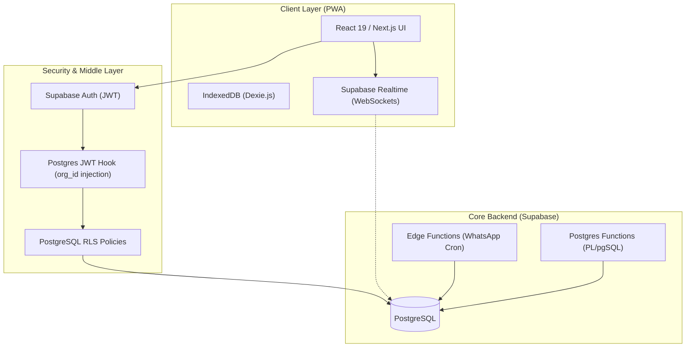
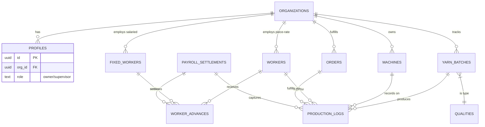
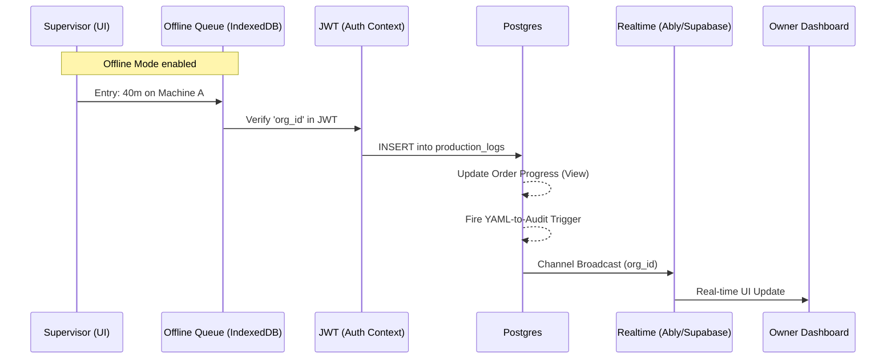

# Vastra Technical Analysis: Architectural Deep-Dive

This document provides a comprehensive technical breakdown of the Vastra Textile SaaS platform, covering infrastructure, database engineering, core logic engines, and security protocols.

---

## 1. High-Level Architecture

Vastra is a **cloud-native, multi-tenant SaaS** built on the **Next.js 14** (App Router) framework. It leverages a "Serverless-Extended" architecture where heavy computation and state management are offloaded to **Supabase** (PostgreSQL-as-a-Platform).

### 1.1 Architecture Diagram

### 1.2 Multi-Tenancy Strategy
Instead of separate databases per client, Vastra uses a **Shared Database / Shared Schema** approach with **Row Level Security (RLS)**.
- **The Fingerprint**: Every table contains an `org_id` column.
- **O(1) Permission Checks**: A custom Postgres hook (`custom_access_token_hook`) injects the user's `org_id` and `user_role` directly into the JWT. This allows RLS policies to check `auth.jwt() ->> 'org_id'` without hitting the `profiles` table on every row scan.

---

## 2. Database Design & Schema ERD

The schema is optimized for **financial integrity** and **manufacturing traceability**.

### 2.1 Entity Relationship Diagram (ERD)

### 2.2 Immutable Audit Trail
Vastra implements an **Event Sourcing-lite** pattern for sensitive operations.
- **Triggers**: PostgreSQL triggers on `workers`, `machines`, and `production_logs`.
- **Snapshots**: Every update stores a `JSONB` snapshot of the "Old" vs "New" state.
- **Access Code Linking**: Destructive mutations require a code from the `access_codes` table, which is then linked to the audit entry for non-repudiation.

---

## 3. Core Domain Engines

### 3.1 The Precision Finance Engine (`lib/finance.ts`)
Standard JavaScript `number` types (IEEE 754) are forbidden for monetary math.
- **Decimal.js**: Used for all piece-rate calculations.
- **Configuration**: 20-digit precision with `ROUND_HALF_UP`.
- **Compliance**: Implements the **50% Legal Deduction Cap** from the *Indian Code on Wages, 2019*.

### 3.2 The Surat Time Engine (`lib/time.ts`)
Factories in Surat operate on local biological clocks, not UTC.
- **Standardization**: All "Today" boundaries are calculated using `date-fns-tz` with the `Asia/Kolkata` zone.
- **Shift Logic**: Handles the 7PM-7AM rollover where a production log might be entered at 1AM but "belongs" to the previous business day's production target.

### 3.3 Sequence: Production Logging Lifecycle

---

## 4. Security, Compliance & Scalability

### 4.1 Access Code Protocol
To prevent supervisor collusion, "Locked" entries (those older than 15 mins or already saved) require an owner-generated code.
- **Entropy**: 6-character alphanumeric (case-insensitive).
- **TTL**: 15 minutes.
- **Security**: Single-use; once a code is consumed, it is marked `is_used` in the database.

### 4.2 Scalability Benchmarks
The system is designed for **High-Write / High-Read** production environments.
- **Horizontal Scaling**: Supabase handles Postgres scaling; the frontend is on Vercel's Edge Network.
- **Concurrent Machines**: Estimated ceiling of **5,000 active machines** per organization before RLS indexing requires partitioning.
- **Write Throttling**: Leverages Upstash Redis rate-limiting on API endpoints to prevent bot flooding.

### 4.3 OSHWC & DPDP Compliance
- **OSHWC**: Digital "Accident Register" (`incidents` table) with structured severity.
- **DPDP Act**: Implements the "Right to Erasure" (via worker soft-deletion while maintaining payroll snapshots) and "Data Minimization" (capturing only required OSHWC fields).

---

## 5. Frontend Engineering & UX

### 5.1 Dependency Audit
| Library | Purpose | Impact |
|---|---|---|
| **Next.js 16** | Full-stack framework | App Router performance, SEO, SSR |
| **TanStack Query** | Server state management | Intelligent caching, auto-refetching on focus |
| **Framer Motion** | UI Micro-interactions | Professional feel, smooth dashboard transitions |
| **Dexie.js** | IndexedDB Wrapper | Foundation for the Offline-First strategy |
| **date-fns-tz** | Timezone logic | Prevents 3:30 AM (UTC) production drift |

### 5.2 Phonetic Transliteration (`lib/transliterate.ts`)
A custom phonetic mapping engine ensures that names entered in English are readable by workers in their native scripts (Hindi/Gujarati) without the need for multi-column database migrations.

---

## 6. Operations & Maintenance

### 6.1 Background Briefs (The Cron Pipeline)
- **Engine**: Supabase Database Webhooks + Edge Functions.
- **Trigger**: `pg_cron` schedule at 20:00 IST.
- **Integration**: WhatsApp Business API (Twilio/Meta) for delivering daily performance summaries to owners.

### 6.2 Data Integrity
- **Double-Lock Settlements**: Once a month is settled, production logs for that month are locked via an RLS policy checking the `payroll_settlements` table, preventing any retroactive meter tampering.

---

**Mission Critical**: This architecture ensures that **Invisible Profit Leakage** (the #1 enemy of factory owners) is made visible through immutable audits, precise math, and real-time observability.
