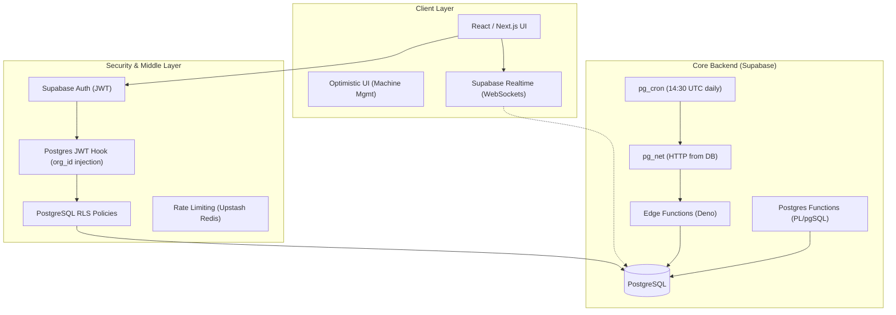
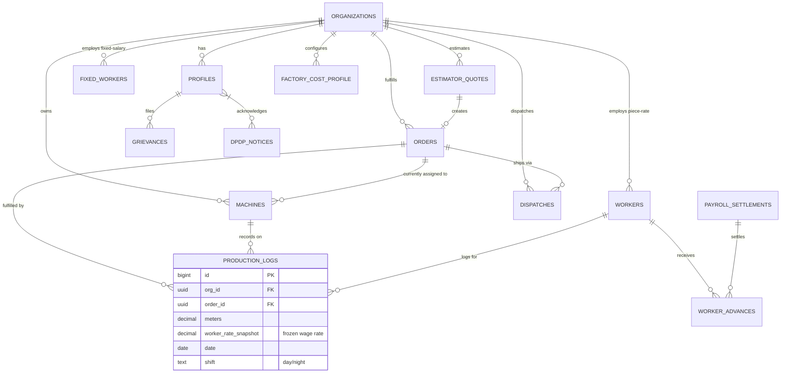

# Weavly Technical Analysis: Architectural Deep-Dive

This document provides a comprehensive technical breakdown of the Weavly Textile SaaS platform, covering infrastructure, database engineering, core logic engines, security protocols, and the WhatsApp notification pipeline.

---

## 1. High-Level Architecture

Weavly is a **cloud-native, multi-tenant SaaS** built on the **Next.js** (App Router) framework. It leverages a "Serverless-Extended" architecture where heavy computation and state management are offloaded to **Supabase** (PostgreSQL-as-a-Platform).

### 1.1 Architecture Diagram

### 1.2 Multi-Tenancy & O(1) RBAC
Weavly uses a **Shared Database / Shared Schema** approach protected by **Row Level Security (RLS)**.
- **`org_id` Fingerprint**: Segregates all data by factory.
- **O(1) Permission Checks**: A Postgres hook (`custom_access_token_hook`) injects the user's `org_id` and `user_role` directly into the JWT `app_metadata`. RLS policies read `auth.jwt() ->> 'org_id'` eliminating the need for expensive JOINs against a profiles table on every query.

---

## 2. Database Design & The Estimator-First Pivot

The database recently evolved into a **Mathematical Profit Protection Engine**. The focus is on the strict sequence: **Estimation (The Gateway) → Quote Approval → Order Generation → Production Tracking → Payroll**.

### 2.1 Entity Relationship Diagram (ERD)

### 2.2 Shift to Estimator-Driven Orders
The most significant architectural shift is the enforcement of orders generated exclusively from the Weavly Estimator:
- **`factory_cost_profile`**: Global factory default tracking for utilities, itemized fixed expenses, and baseline parameters.
- **`estimator_quotes`**: Snapshot table storing fully resolved costing recipes (JSON arrays defining structural weft/warp constraints and percentage-based overheads).
- **Convert-to-Order**: When a quote converts, the order directly maintains the wage and expected production targets natively, ensuring a seamless transition from estimation to floor operations.

### 2.3 Immutable Audit Trail & Lock Strategies
- **Worker Rate Snapshots**: `production_logs.worker_rate_snapshot` permanently locks the exact point-in-time wage. Any future rate changes applying to the order will *never* alter historical payroll math.
- **RLS Double-Lock**: Settled months establish a `payroll_settlements` record. Database-level RLS policies strictly reject any attempts to retroactively INSERT or UPDATE production logs for a locked worker cycle.
- **Event-Sourced Diffs**: Postgres Triggers feed a persistent `audit_log`, transforming database mutations into human-readable diff events (linked securely to Owner Access Codes).

---

## 3. Core Domain Engines

### 3.1 The Estimator Calculation Engine
A multi-layered React-state calculation engine simulating Surat-standard weaving equations:
- Applies formulaic PPI-based weave costs, precise weft consumption outputs, and per-row GST application.
- Utilizes combined shortage modeling mapped transparently over total production cost.

### 3.2 The Precision Finance Engine (`lib/finance.ts`)
Standard IEEE 754 floating-point behavior is strictly forbidden for wages.
- Relies on **Decimal.js** (20-digit precision, `ROUND_HALF_UP`).
- Implements exact logic to respect the **50% Legal Deduction Cap** (Code on Wages, India), auto-rolling excess debt to subsequent pay cycles.

### 3.3 The Surat Time Engine (`lib/time.ts`)
Factories are localized bio-clocks. 
- Uses `date-fns-tz` pegged permanently to `Asia/Kolkata`.
- Handles the factory Day/Night shift boundaries, preventing logs written at 2AM from bleeding into the current calendar day natively. `new Date()` is banned for business logic.

### 3.4 DPDP 2026 & Compliance Engine
A globally scoped administrative overlay that ensures alignment with upcoming legal frameworks:
- **Notice Registry**: Admins maintain version-controlled privacy notices. The engine forces users across all multi-tenant boundaries to acknowledge the latest notices.
- **Grievance Redressal**: A unified ticketing system supporting anonymous and named grievance logging, backed by an immutable audit trail.
- **Data Sovereignty**: Dispatches, payroll, and logs are cryptographically isolated via RLS, preventing any cross-tenant data leaks.

---

## 4. WhatsApp Notification Pipeline (Serverless)

An entirely serverless, cron-driven infrastructure for factory observability, decoupled from client-side events. The pipeline uses **Interakt** (Meta-approved BSP) for delivery and is designed to be fully resilient on the Free Tier without requiring webhook callbacks.

**7 Edge Functions** handle distinct notification types:
- `send-daily-brief` — daily production summary to owners (20:00 IST)
- `check-pace-index` — deadline risk alerts scanned every 6 hours
- `monthly-brief` — monthly payroll summary (28th of each month at 23:30 IST)
- `send-access-code` — security codes pushed to owner's WhatsApp instantly
- `send-payslip` — worker payslips on payroll settlement
- `send-advance-receipt` — instant advance receipts to workers
- `retry-failed-messages` — hourly cron retrying failed sends (max 3 per 24h)

> **See the full guide:** [WHATSAPP_INTEGRATION_GUIDE.md](./WHATSAPP_INTEGRATION_GUIDE.md) — detailed setup instructions, template variable mappings, SQL configuration steps, and monitoring guidance.

---

## 5. Scalability & Error Catching

### 5.1 Optimistic Mutations 
Weavly avoids factory floor network blocking. Heavy mutations (like assigning Machines to Orders) occur via highly optimistic TanStack queries. The Next.js client renders the assignment instantly; a background queue confirms with Supabase and silently rolls back on error.

### 5.2 Server Action Nuances 
Client-to-server interaction routes through Next.js Server Actions hardened by **Zod validation schemas**. Missing states or empty null parameters generated by the `CASE WHEN` logic in SQL views are handled defensively to avoid crashing UI layers.

### 5.3 Tri-layer Sentry Tracing
Full error capture exists uniformly across:
- Browser runtimes (`sentry.client.config.ts`)
- Next.js SSR functions (`sentry.server.config.ts`)
- Supabase Edge Functions (`sentry.edge.config.ts`)

**End State**: A deeply resilient, math-focused pipeline emphasizing performance, undeniable financial lineage, and rapid response.
