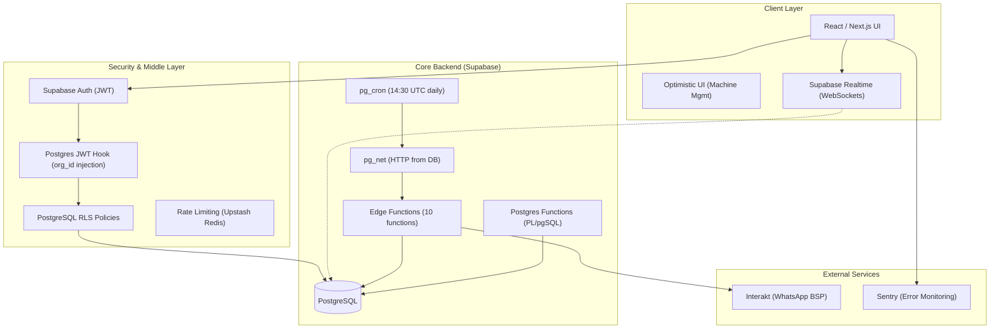
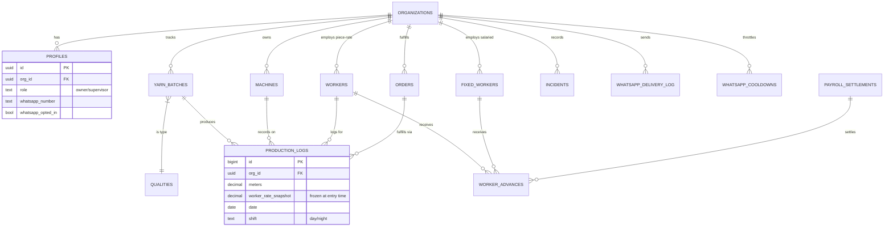
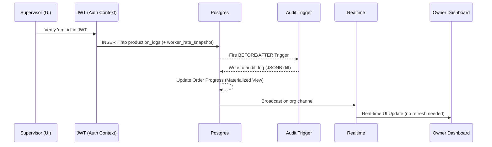
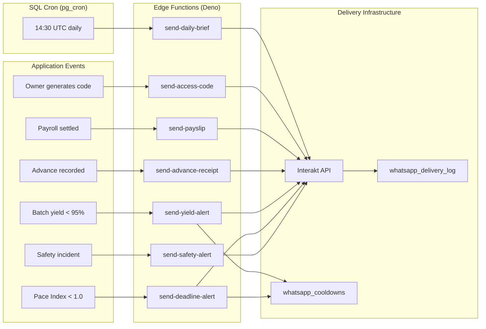

# Vastra Technical Analysis: Architectural Deep-Dive

This document provides a comprehensive technical breakdown of the Vastra Textile SaaS platform, covering infrastructure, database engineering, core logic engines, security protocols, and the WhatsApp notification pipeline.

---

## 1. High-Level Architecture

Vastra is a **cloud-native, multi-tenant SaaS** built on the **Next.js** (App Router) framework. It leverages a "Serverless-Extended" architecture where heavy computation and state management are offloaded to **Supabase** (PostgreSQL-as-a-Platform).

### 1.1 Architecture Diagram


### 1.2 Multi-Tenancy Strategy
Instead of separate databases per client, Vastra uses a **Shared Database / Shared Schema** approach with **Row Level Security (RLS)**.
- **The Fingerprint**: Every table contains an `org_id` column.
- **O(1) Permission Checks**: A custom Postgres hook (`custom_access_token_hook`) injects the user's `org_id` and `user_role` directly into the JWT. This allows RLS policies to check `auth.jwt() ->> 'org_id'` without hitting the `profiles` table on every row scan.

---

## 2. Database Design & Schema

The schema is optimized for **financial integrity** and **manufacturing traceability**. There are currently **50 migrations** tracking the full database evolution.

### 2.1 Entity Relationship Diagram (ERD)


### 2.2 Key Schema Design Decisions

#### Rate Snapshot Pattern
`production_logs.worker_rate_snapshot` stores the **exact ₹/meter rate at the time of logging**, copied from `qualities.default_worker_rate_per_m` at INSERT time. This is a critical financial integrity mechanism:
- Future quality rate changes cannot corrupt past payroll calculations.
- All settlement math uses this snapshot column, never the live rate.
- Historic records are provably accurate even years later.

#### Inventory Deletion Guards
The application layer enforces **referential integrity** before deleting Quality definitions. A quality that is referenced by one or more active yarn batches is rejected at the API level — no orphaned batches can exist silently.

#### Double-Lock Settlements
Once a month is settled (`payroll_settlements` record exists), the RLS policy for `production_logs` prevents any retroactive meter entry for that month-worker combination. This is a two-layer lock:
1. `payroll_settlements` foreign key makes the settlement "real."
2. RLS policy rejects INSERTs/UPDATEs for logs in settled periods.

### 2.3 Immutable Audit Trail
Vastra implements an **Event Sourcing-lite** pattern for sensitive operations.
- **Triggers**: PostgreSQL triggers on `workers`, `machines`, `production_logs`, `yarn_batches`, `qualities`, `payroll_settlements`, and `incidents`.
- **Snapshots**: Every update stores a `JSONB` snapshot of the "Old" vs "New" state in `audit_log`.
- **Access Code Linking**: Destructive mutations require a code from the `access_codes` table, which is then linked to the audit entry for non-repudiation.
- **Human-Readable Display**: The UI translates JSONB diffs into plain English ("Changed Rate from ₹2.50 to ₹2.60") — no raw JSON shown to owners.

---

## 3. Core Domain Engines

### 3.1 The Precision Finance Engine (`lib/finance.ts`)
Standard JavaScript `number` types (IEEE 754) are forbidden for monetary math.
- **Decimal.js**: Used for all piece-rate calculations.
- **Configuration**: 20-digit precision with `ROUND_HALF_UP`.
- **Compliance**: Implements the **50% Legal Deduction Cap** from the *Indian Code on Wages, 2019*.
- **NaN Guard**: All inputs are sanitized before arithmetic to prevent `meters * undefined = NaN` corrupting financial records.

### 3.2 The Surat Time Engine (`lib/time.ts`)
Factories in Surat operate on local biological clocks, not UTC.
- **Standardization**: All "Today" boundaries are calculated using `date-fns-tz` with the `Asia/Kolkata` zone.
- **Shift Logic**: Handles the 7PM–7AM rollover where a production log entered at 1AM "belongs" to the previous business day's production target.
- **Rule**: `new Date()` is never used for "Today" logic anywhere in the codebase. Always use `getSuratDate()` or `getSuratTodayString()`.

### 3.3 Payroll Settlement RPC (`settle_worker_payroll`)
The settlement process runs entirely in a single PL/pgSQL transaction:
1. Sums all `pending` advances for the worker.
2. Calculates deduction cap (50% of gross, or 100% for final settlement).
3. Deducts advances oldest-first; **splits** advances if partial deduction is needed (remainder becomes a new `pending` advance for next cycle).
4. Writes a locked `payroll_settlements` snapshot record.
5. Updates all fulfilled advances to `deducted` status, linked to the settlement ID.
6. Returns carry-forward debt to the caller.

This is fully reversible via `unsettle_worker_payroll`, which restores all linked advances to `pending` and deletes the settlement record.

### 3.4 Sequence: Production Logging Lifecycle


---

## 4. WhatsApp Notification Pipeline

### 4.1 Architecture
Vastra's notification system is **entirely serverless** and runs via 10 Supabase Edge Functions (Deno runtime) calling the **Interakt** WhatsApp Business API.



### 4.2 The Daily Brief Cron (SQL-Native)
The cron is defined in a **migration file** (`20260401030000_pg_cron_schedule.sql`), not in any external scheduler. This makes it version-controlled and infra-independent.

```sql
-- Fires at 14:30 UTC = 20:00 IST
SELECT cron.schedule(
    'vastra-daily-brief',
    '30 14 * * *',
    $$ SELECT net.http_post(url := ..., headers := ..., body := '{}') $$
);
```

The `get_daily_brief_stats(org_id, date)` RPC computes the daily summary (total meters, active orders, avg efficiency, estimated loss, piece-rate wages) in a single SQL query, called by the Edge Function.

### 4.3 Cooldown System
`whatsapp_cooldowns` prevents alert spam:
- **`yield_alert`**: Fires once per batch close (keyed on `batch_id`).
- **`deadline_risk`**: 24-hour TTL per order (keyed on `order_id`).
- The table uses a composite primary key `(org_id, alert_type, ref_id)` so deduplication is a single upsert.

### 4.4 Delivery Audit
Every outbound message is logged to `whatsapp_delivery_log` with:
- `notification_type` (7 possible values)
- `status` (`sent` / `delivered` / `read` / `failed`)
- `payload_snapshot` (full Interakt payload for debugging)
- `interakt_callback_data` (for webhook tracing)

Owners can read their own org's delivery log. Only `service_role` (Edge Functions) can write — no client-side inserts possible.

---

## 5. Security, Compliance & Scalability

### 5.1 Access Code Protocol
To prevent supervisor collusion, "Locked" entries require an owner-generated code.
- **Entropy**: 6-character alphanumeric (case-insensitive).
- **TTL**: 15 minutes.
- **Security**: Single-use; once consumed, marked `is_used` and linked to the audit entry.
- **Remote Delivery**: Owners receive the code on WhatsApp via `send-access-code` Edge Function — physical presence is not required.

### 5.2 JWT-Based RLS (O(1) Permission Checks)
The `custom_access_token_hook` Postgres function is called after every Supabase Auth login. It injects `org_id` and `user_role` directly into the JWT payload. RLS policies read from `auth.jwt()` rather than joining `profiles`, making every policy check zero extra queries.

### 5.3 Rate Limiting
API endpoints are protected by **Upstash Redis** rate limiting (`lib/rate-limit.ts`), preventing bot flooding and brute-forcing of access codes.

### 5.4 Scalability Benchmarks
- **Horizontal Scaling**: Supabase handles Postgres scaling; the frontend is on Vercel's Edge Network.
- **Concurrent Machines**: Estimated ceiling of **5,000 active machines** per organization before RLS indexing requires partitioning.
- **Write Throttling**: Upstash Redis rate-limiting on API endpoints.

### 5.5 OSHWC & DPDP Compliance
- **OSHWC**: Digital "Accident Register" (`incidents` table) with structured severity (Minor / Major / Critical).
- **DPDP Act**: Implements the "Right to Erasure" (worker soft-deletion while maintaining payroll snapshots) and "Data Minimization" (capturing only required OSHWC fields).

---

## 6. Frontend Engineering & UX

### 6.1 Dependency Audit

| Library | Purpose | Notes |
|---|---|---|
| **Next.js** | Full-stack framework | App Router, SSR, Edge Middleware |
| **TanStack Query** | Server state management | Intelligent caching, auto-refetching |
| **Framer Motion** | UI micro-interactions | Smooth dashboard transitions |
| **date-fns-tz** | Timezone logic | Prevents 3:30 AM UTC drift |
| **Decimal.js** | Monetary arithmetic | 20-digit precision, ROUND_HALF_UP |
| **shadcn/ui** | Component library | Tailwind-based, accessible |
| **Sentry** | Error monitoring | Client + Server + Edge configs |

### 6.2 Optimistic Updates (Machine Management)
The machine management interface applies state changes **locally and immediately** before the async Supabase call resolves. If the database call fails, the UI rolls back. This eliminates perceived latency on the factory floor where operators need instant confirmation.

### 6.3 Phonetic Transliteration (`lib/transliterate.ts`)
A custom phonetic mapping engine ensures that names entered in English are readable by workers in their native scripts (Hindi/Gujarati) without the need for multi-column database migrations. WhatsApp messages also respect the worker's stored `whatsapp_language` preference.

### 6.4 Real-Time Channels
Supabase Realtime channels are scoped by `org_id`. When a supervisor logs production, the database broadcasts to the owner's open browser tab instantly. No polling.

---

## 7. Operations & Maintenance

### 7.1 Background Notification Pipeline
The cron-to-Edge-Function chain is the backbone of proactive notifications:

| Step | Mechanism |
|---|---|
| Trigger | `pg_cron` fires at 14:30 UTC |
| HTTP call | `pg_net.http_post` from within Postgres |
| Handler | `send-daily-brief` Edge Function (Deno) |
| Data fetch | `get_daily_brief_stats` RPC |
| Dispatch | Interakt API (per opted-in owner) |
| Audit | `whatsapp_delivery_log` INSERT |

### 7.2 Data Integrity Guarantees

| Mechanism | What it protects |
|---|---|
| `worker_rate_snapshot` | Historic payroll math is immutable to rate changes |
| `payroll_settlements` snapshot | Settled months cannot be retroactively altered |
| RLS double-lock | Production logs in settled months are write-locked |
| Access code audit trail | Every protected action is non-repudiably linked to owner approval |
| Inventory deletion guard | Active-batch qualities cannot be deleted |
| WhatsApp cooldowns | Duplicate alerts cannot spam owners |

### 7.3 Error Monitoring
Sentry is configured for three runtimes — client (`sentry.client.config.ts`), server (`sentry.server.config.ts`), and edge (`sentry.edge.config.ts`) — giving full coverage across the Next.js rendering pipeline.

---

**Mission Critical**: This architecture ensures that **Invisible Profit Leakage** — the #1 enemy of factory owners — is made visible through immutable audits, precise math, real-time observability, and proactive WhatsApp intelligence.
