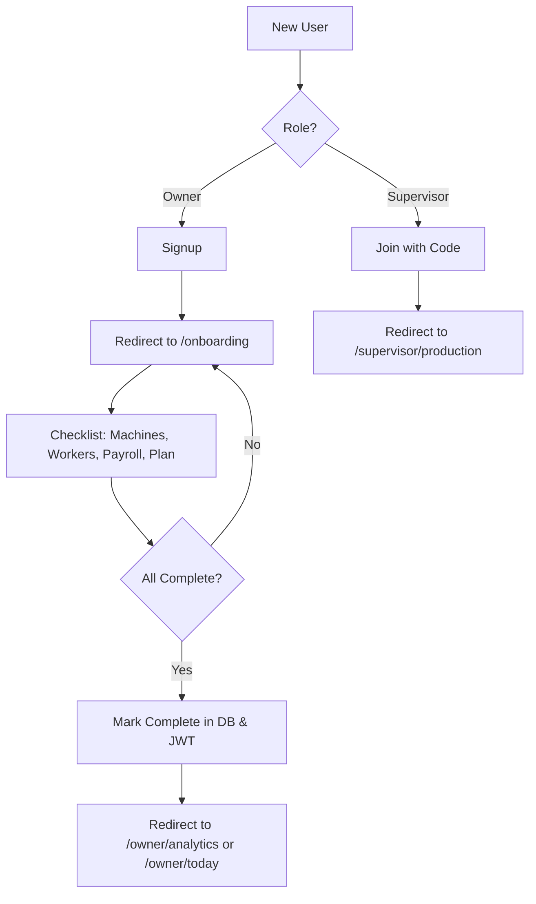

# Current Onboarding Implementation

## 1. Executive Summary

- **What onboarding currently does:** The current onboarding flow is a blocking gate for **Owner** users. It requires them to complete a 4-step checklist: adding at least one machine, adding at least one worker, setting a payroll cycle start day, and choosing a subscription plan (or starting a trial). Until this is done, they cannot access the main dashboard.
- **Who it is for:** It is exclusively for the **Owner** role. **Supervisor** users skip this flow entirely and are dropped directly into the supervisor dashboard after joining.
- **What roles are involved:** 
  - **Owner**: The primary user who creates the organization and completes the onboarding setup.
  - **Supervisor**: Team members invited via a join code. They do not participate in onboarding.
- **What the current intended user journey appears to be:**
  1. Owner signs up and creates an organization.
  2. Owner is redirected to `/onboarding`.
  3. Owner completes the 4 steps (Machines, Workers, Payroll, Plan).
  4. Owner clicks "Go to dashboard" and lands on `/owner/analytics` (or `/owner/today` depending on the file).
- **Whether onboarding feels complete, partial, or fragile based on the code:** It feels **partial and slightly fragile**. 
  - It is **partial** because it only collects names of machines and workers, leaving out critical data like rates, qualities, and worker types (fixed vs meter) that are needed for the core loop (Estimator, Production).
  - It feels **fragile** due to documented race conditions in the code (e.g., JWT hook lag on fresh signup) and inconsistencies in redirect destinations between files (some use `/owner/today`, others `/owner/analytics`).
- **Whether the flow is role-based, organization-based, factory-based, or user-based:** It is **organization-based and role-gated**. The state is stored on the `organizations` table (`onboarding_complete`), and the gate applies only to users with the `owner` role.

## 2. Route Map

| Route Path | File Path | Component/Page | Access | Redirect Destination | Linked From |
|---|---|---|---|---|---|
| `/onboarding` | `app/(auth)/onboarding/page.tsx` | `OnboardingPage` | Authenticated Owners | `/owner/analytics` or `/owner/today` | Middleware, Auth Callback |
| `/signup` | `app/(auth)/signup/page.tsx` | `SignupPage` | Public | `/onboarding` (via action) | Login page |
| `/join` | `app/(auth)/join/page.tsx` | `JoinPage` | Public | `/supervisor/production` | Signup page |
| `/login` | `app/(auth)/login/page.tsx` | `LoginPage` | Public | Role-based home path | - |
| `/auth/callback` | `app/auth/callback/route.ts` | Server Route | Public | Role/Onboarding based | Supabase Auth |

- **Access Controls:**
  - `/onboarding` is gated in `middleware.ts`. If an owner has `onboarding_complete = false`, they are redirected here from any non-allowed route.
  - Allowed routes during onboarding (for owners): `/api/`, `/onboarding`, `/owner/machines`, `/owner/workers`, `/owner/settings`.

## 3. Authentication and Redirect Flow

1. **Login / Signup:**
   - Owner signs up at `/signup`. `createOrganizationAndRedirect` action creates the user, organization, and profile, then signs them in and redirects to `/onboarding`.
2. **Auth Callback:**
   - `app/auth/callback/route.ts` handles the code exchange.
   - If user is `owner` and `onboarding_complete` is false, it redirects to `/onboarding`.
   - If complete, it redirects to `/owner/analytics`.
3. **Role Detection:**
   - Uses JWT claims injected by `custom_access_token_hook`.
   - Fallback to DB query (`profiles` table) if JWT claims are stale.
4. **Onboarding Detection:**
   - Checked in `middleware.ts` and `OnboardingPage`.
   - Reads `onboarding_complete` from organizations table or JWT claim.
5. **Final Landing Page:**
   - `middleware.ts` points owners to `/owner/today` when complete.
   - `OnboardingPage` and `auth/callback` point owners to `/owner/analytics`.
   - Supervisors go to `/supervisor/dashboard` or `/supervisor/production`.

- **Inconsistencies:**
  - `middleware.ts` (Line 226) redirects to `/owner/today`.
  - `OnboardingPage` (Line 31) redirects to `/owner/analytics`.
  - `checklist.tsx` (Line 668) redirects to `/owner/analytics`.

## 4. Database Model Related to Onboarding

### Tables and Columns

| Table Name | Column Name | Type | Purpose | Default | Required for Onboarding |
|---|---|---|---|---|---|
| `organizations` | `onboarding_complete` | BOOLEAN | Tracks if setup is done | `false` | Yes |
| `organizations` | `join_code` | TEXT | Code for supervisors | Generated | No |
| `organizations` | `join_code_expires_at`| TIMESTAMPTZ | Expiry for join code | `now() + 30 days`| No |
| `profiles` | `role` | TEXT | `owner` or `supervisor`| - | Yes |
| `profiles` | `org_id` | UUID | Links user to org | - | Yes |
| `machines` | - | - | At least 1 row required | - | Yes |
| `workers` | - | - | At least 1 row required | - | Yes |
| `payroll_configs`| - | - | Must exist | - | Yes |
| `org_subscriptions`| - | - | Active sub or trial | - | Yes |

- **RPCs Used:** None directly in the checklist file, but `getOnboardingStatus` queries the database directly.
- **Triggers:** `custom_access_token_hook` is a function used in a Supabase hook to inject claims.
- **RLS Policies:** 
  - `organizations`: Select requires session, Update requires `owner_id = auth.uid()`.
  - `profiles`: Select allows viewing own or same org.
  - `workers` & `machines`: Only owners can manage (All), members can view (Select).

## 5. Current Onboarding Steps

The flow is step-based in `OnboardingChecklist` (`app/(auth)/onboarding/checklist.tsx`).

### Step 1: Add your machines
- **Route:** `/onboarding` (Client Component)
- **Component:** `MachineForm`
- **Purpose:** Add initial machines.
- **Inputs:** Machine names (Manual or Bulk import).
- **Validation:** At least one machine name.
- **Database Writes:** Inserts into `machines` table.
- **Completion Condition:** `machines` count > 0.
- **Next Route:** Auto-opens next step.

### Step 2: Add your workers
- **Route:** `/onboarding`
- **Component:** `WorkerForm`
- **Purpose:** Add initial piece-rate workers.
- **Inputs:** Worker name, Phone (optional).
- **Validation:** At least one worker name. 10-digit phone if provided. Consent checkbox required if phone provided.
- **Database Writes:** Inserts into `workers` table. Inserts into `worker_whatsapp_consent` or similar (via `saveWorkerWhatsApp`).
- **Completion Condition:** `workers` count > 0.

### Step 3: Set your pay cycle
- **Route:** `/onboarding`
- **Component:** `PayrollCycleForm`
- **Purpose:** Define monthly payroll period.
- **Inputs:** Day of month (1-28).
- **Validation:** Must select a day.
- **Database Writes:** Inserts/Updates `payroll_configs` table.
- **Completion Condition:** `payroll_configs` row exists.

### Step 4: Choose your plan
- **Route:** `/onboarding`
- **Component:** `PlanSelectionForm`
- **Purpose:** Start trial or subscribe.
- **Inputs:** Plan selection (Trial, Base, Premium).
- **Database Writes:** Creates `org_subscriptions` row.
- **Completion Condition:** Valid subscription exists.

## 6. Role-Based Onboarding Behavior

- **Owner:**
  - Creates organization during signup.
  - Blocked by `/onboarding` until all 4 steps are complete.
  - Can bypass specific gates if they navigate to allowed routes like `/owner/machines` or `/owner/workers` directly, but `middleware.ts` restricts access to main dashboard areas.
- **Supervisor:**
  - Joins via code at `/join`.
  - Does not see onboarding.
  - Lands on `/supervisor/production` or `/supervisor/dashboard`.
  - Cannot onboard without owner setup because they need a join code generated by an organization.

## 7. UI and UX Inventory

- **Component:** `OnboardingChecklist` in `app/(auth)/onboarding/checklist.tsx`.
- **Purpose:** Renders the checklist UI.
- **Form Fields:** 
  - Machine names (text or textarea).
  - Worker names and phones.
  - Day selector for payroll.
  - Plan buttons.
- **Polished or Placeholder:** The UI looks **polished** with Framer Motion animations and a clean layout.
- **Clarity:** It explains what the steps are, but does not explain *why* they are needed in depth (except for payroll cycle).
- **Friction:** Bulk import helps reduce friction.
- **Terms:** Uses English terms.

## 8. Business Setup Coverage

| Item | Coverage | Notes |
|---|---|---|
| Factory Profile | Partially covered | Name collected at signup |
| Owner Profile | Partially covered | Name, Email, Phone at signup |
| Loom/Machine Setup | Partially covered | Name only. No type or specific config |
| Quality Setup | Not covered | Comment says "no longer a mandatory gate" |
| Worker Setup | Partially covered | Name and phone only. No rate or type |
| Day/Night Assignment| Not covered | - |
| Rate Setup | Not covered | - |
| Stock Setup | Not covered | - |
| Payroll Basics | Partially covered | Cycle start day only |

## 9. Data Dependencies and Activation Requirements

### Prerequisite Data for Core Loop:

- **Estimator:** Needs qualities and rates. (Not collected in onboarding).
- **Quotes:** Needs customer data, qualities. (Not collected).
- **Production Logging:** Needs machine, worker, and quality (often). Onboarding collects machines and workers but not qualities or rates.
- **Supervisor Dashboard:** Needs assigned workers and machines.

- **Does onboarding collect enough data to activate?** **No**. A user landing on the dashboard after onboarding will still need to set up rates and qualities before they can actually use the estimator or log production properly.

## 10. State Management

- **Stored in DB:** Yes, `onboarding_complete` in `organizations` table.
- **Cached:** In JWT claims (`onboarding_complete`).
- **Inferred:** `getOnboardingStatus` infers state by counting rows in `machines`, `workers`, `payroll_configs`, and `org_subscriptions`.
- **Race Conditions:** Documented in `auth.ts` regarding JWT hook lag. Handled with timeouts and DB fallbacks.

## 11. Validation and Error Handling

- **Validation:** 
  - Client-side validation in forms (e.g., phone length, empty names).
  - Server-side validation via Zod schemas in actions (implied by imports).
- **Error Handling:** 
  - Uses `sonner` toasts for errors.
  - Server actions return `{ error: string }` instead of throwing in many cases to avoid crashing.

## 12. Tests and QA Coverage

- **No specific onboarding tests found** in `__tests__`.
- Missing high-priority tests:
  - E2E flow from signup to dashboard.
  - Redirect checks for incomplete onboarding.
  - Edge cases like refreshing mid-onboarding.

## 13. Edge Cases and Failure Modes

- **User signs up but profile not created:** Handled by rolling back (deleting user) if profile creation fails in `createOrganization`.
- **JWT stale on signup:** Handled by waiting 500ms and refreshing session in action, plus DB fallbacks in pages.
- **User refreshes mid-onboarding:** State is preserved because data is saved to DB on each step completion.

## 14. Churn and Activation Risk Assessment

- **Time to first value:** Slow. User must fill data that isn't immediately usable without further setup (rates, qualities).
- **Scores (out of 10):**
  - Technical completeness: 7/10 (Handles race conditions well).
  - UX clarity: 8/10 (Good UI).
  - Activation readiness: 4/10 (Does not collect enough data for core loop).
  - Churn risk reduction: 5/10 (Might lose users who find empty dashboard after setup).

## 15. Gaps, Duplicates, and Inconsistencies

- **Inconsistent Redirects:** 
  - `middleware.ts` -> `/owner/today`
  - `checklist.tsx` -> `/owner/analytics`
  - `auth/callback` -> `/owner/analytics`
- **Missing Coverage:** Qualities and Rates are missing from onboarding but needed for value.

## 16. Recommended Next Investigation Areas

- Should we make Quality setup part of onboarding again?
- Should we allow skipping steps or progressive profiling?
- Is `/owner/today` or `/owner/analytics` the correct landing page?

## 17. Proposed Current-State Flow Diagram

## 18. File Inventory Appendix

- `middleware.ts`: Controls redirects and gates.
- `app/(auth)/onboarding/page.tsx`: Server component for onboarding page.
- `app/(auth)/onboarding/checklist.tsx`: Client component with forms.
- `app/(auth)/actions/auth.ts`: Server actions for auth and onboarding status.
- `supabase/migrations/20260403000000_f1_auth_onboarding.sql`: Schema updates.

## 19. Final Summary for Product Discussion

1. **What does onboarding currently do?** Gates owners until they add at least 1 machine, 1 worker, set payroll cycle, and pick a plan.
2. **What is missing?** Critical data for the core loop: Rates and Qualities.
3. **What is risky?** Inconsistent landing routes and incomplete data setup leading to empty states on dashboard.
4. **What should we be careful not to break?** The JWT claim fallback logic that handles race conditions.
5. **Opportunities:** Improve activation by guiding users to set up rates or qualities immediately after onboarding or as part of it.
