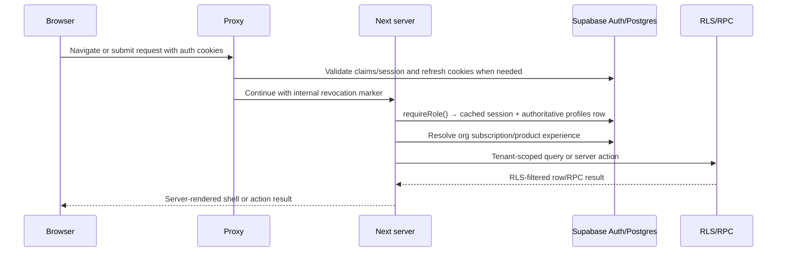
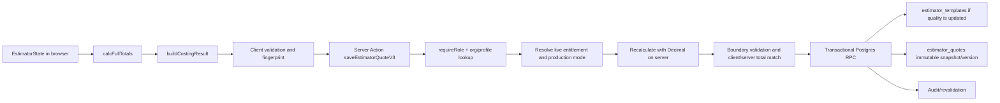
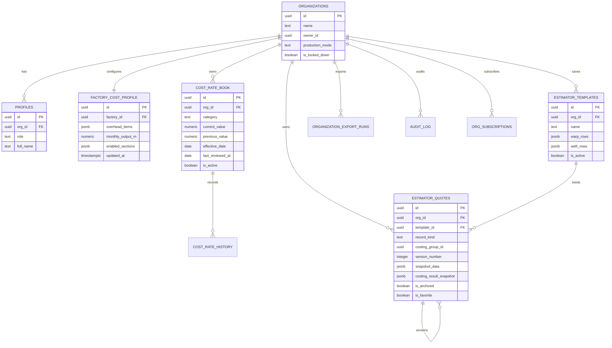

# Weavly technical specification

**Audience:** software engineer joining the project

**Repository snapshot:** 10 August 2026

**Primary scope:** Base Plan / Weavly Estimator, with enough Full Suite context to explain the shared architecture

## 1. Product and architectural summary

Weavly is a multi-tenant SaaS application for Indian weaving factories. The Base Plan is a focused costing product with a small owner-only production core: an owner maintains yarn and factory cost assumptions, calculates the cost of a fabric quality, saves reusable recipes and immutable costing snapshots, can turn a costing into a lightweight production job, records metres, and settles simple piece-rate pay.

The larger application shares the same estimator foundation but adds a factory operating loop:

```text
Current assumptions
  ├─ Yarn Rate Book
  └─ Factory Cost Profile
          │
          ▼
Fabric Quality / recipe
          │
          ▼
Cost Estimate snapshot (Base)
          │
          ├─ compare, archive, restore, export
          ├─ Base Production Core: job → owner metre entry → piece-rate settlement
          └─ Full Suite only: quotation → order or market run
                                      │
                                      ▼
                         production → stock → dispatch
                                      │
                                      ▼
                              commercials/payroll
```

The core design decision is that an estimate is not recalculated from today’s defaults after it has been saved. The saved row contains the recipe, inputs, derived numbers, calculation version, rounding policy, and an immutable `costing_result_snapshot`. Later Rate Book or factory-profile changes affect future estimates only.

## 2. Plan boundary

### Base Plan capabilities

| Surface | Route | Base behavior |
|---|---|---|
| Costing editor | `/owner/estimator` | Calculate a standalone Cost Estimate. The page does the interactive calculation locally and the server recomputes/validates before persistence. |
| Yarn Rate Book | `/owner/rates` | Maintain reviewed organization-scoped rates, review dates, sources, history, archive/restore, and future-estimate defaults. |
| Saved Costings | `/owner/quotes` | Base labels this surface “Saved Costings.” It lists standalone `record_kind = 'costing'` snapshots and their versions. |
| Factory defaults | `/owner/settings` | Configure factory costing defaults, overhead basis, optional cost sections, and saved qualities. |
| Production Core | `/owner/production` | Create a job from an active costing, record owner-entered metres, maintain a small piece-rate worker roster, record advances, and settle basic pay. |
| Customer-safe document | Costing export dialog | Generate a customer-facing quotation PDF from a costing snapshot. This is a document artifact, not a durable Base quotation lifecycle. |
| Internal document | Costing export dialog | Generate a detailed internal cost sheet with assumptions and internal economics. |
| Draft recovery | Estimator client | Autosave a meaningful in-progress editor state to browser storage, scoped by organization and user, for up to 24 hours. |
| Organization export | `/owner/data-export` | Owner-only redacted JSON export of the organization’s data, including costing and billing datasets. It remains available after plan access ends according to the product contract. |
| Billing | `/owner/billing` | View and manage the Weavly Estimator subscription, annual pricing state, renewal/cancel state, payments, and referral information. |

### Full Suite-only context

The following surfaces are outside Base entitlement even though the codebase contains them:

- Factory Today and owner analytics
- Party Orders and quotation lifecycle
- Market Runs
- formal production logs and supervisor floor workflows (Base has a separate owner-only metre-entry flow)
- stock/godown, sales, dispatches, and receipt reconciliation
- Commercials/receivables
- Full Suite workers, machines, attendance, fixed/statutory payroll, and formal Upaad/advance controls (Base has a separate simple piece-rate roster/advance flow)

Base and Full Suite share the calculation engine, Rate Book, snapshot model, comparison model, and export system. A Base upgrade does not reinterpret existing `costing` rows as quotations.

## 3. Technology stack

| Layer | Current implementation | Responsibility |
|---|---|---|
| Web framework | Next.js `16.2.12`, App Router | Routing, layouts, server components, server actions, route handlers, static/public pages. |
| UI runtime | React `19.2.7`, TypeScript 5, strict mode | Interactive editors, dialogs, client state, typed server/client boundary. |
| Styling/components | Tailwind CSS 4, local shadcn/ui components, Radix primitives, `lucide-react` | Responsive operational UI with touch-friendly controls. |
| Data client | `@supabase/supabase-js`, `@supabase/ssr` | Browser/server Supabase clients, Auth session cookies, Postgres reads/writes, Realtime. |
| Database | Supabase Postgres | Tenant-scoped relational data, JSONB recipe/snapshot fields, RLS, indexes, functions, triggers, RPC transactions. |
| Client data state | TanStack Query 5 | Interactive reads/mutations, invalidation, request-level cache behavior, scoped persisted query cache. |
| Calculation | `decimal.js` plus `lib/estimator.ts` | High-precision textile costing and normalized INR snapshot values. |
| Documents | `jspdf` plus HTML/CSS export model | Internal cost sheets and customer-safe quotation PDFs generated in the browser. |
| Browser persistence | `localStorage`, TanStack persisted query cache, Dexie-backed mutation infrastructure | Draft recovery, scoped cache, and selected offline/session cleanup. This is not a promise that Base writes are fully offline-first. |
| PWA | `@ducanh2912/next-pwa`, Workbox | Installable PWA shell, offline document fallback, static-asset caching, protected-data network boundaries. |
| Billing | Razorpay APIs and webhooks | Subscription creation, verification, lifecycle events, payment records, invoices/receipts. |
| Rate limiting | Upstash Redis via `@upstash/ratelimit` when configured | Auth, join-code, access-code, public POST, and destructive-action throttles. |
| Observability | Sentry for client, Node, and Edge | Error capture, request errors, traces, redaction, deployment attribution. |
| Messaging | Meta WhatsApp Cloud API via Supabase Edge Functions | Full Suite operational messages; not a dependency of the Base estimator workflow. |
| Hosting | Vercel configuration; `vercel.json` pins region `bom1` | Production/preview deployment and server execution. |

Commercial amounts in billing are represented in **paise**. Costing values in the estimator are numeric INR values and are rounded into the persisted snapshot using the explicit costing rounding policy.

## 4. Repository map

```text
app/
  (auth)/                         Signup, login, join, onboarding, password flows
  (dashboard)/owner/              Owner pages, layouts, server actions, client workspaces
  (dashboard)/supervisor/         Full Suite floor workflows
  api/                            Billing, referrals, telemetry, webhook route handlers
components/
  estimator/                      Estimator editor/export UI
  settings/                       Factory defaults, saved qualities, settings controls
  billing/                        Plan gates, checkout, billing UI
  navigation/                     Owner/supervisor navigation and mobile shell
  ui/                             Reusable shadcn/Radix-style primitives
hooks/                            Autosave, query/offline/session helpers
lib/
  estimator.ts                    Canonical costing state, formulas, result builder, snapshot parser
  estimator-validation.ts         Client/server boundary validation
  estimator-export.ts              Export model, privacy modes, print HTML, filenames
  saved-costings.ts                Saved-quality reconstruction, sorting, comparison, metrics
  cost-rates.ts                   Rate Book types, review status, reconciliation helpers
  costing-workspace.ts            Costing/quotation/market-run capability model
  subscription*.ts                Entitlement resolution and plan gates
  auth.ts                         Server-side session/profile/role enforcement
  supabase/                       Server, browser, admin, and database helpers
  db.ts                           IndexedDB/Dexie mutation infrastructure
  time.ts                          Surat/India date helpers
  rate-limit.ts                   Upstash-backed throttling
  perf.ts                         Route/query performance instrumentation
  sentry-redaction.ts             Sensitive-event filtering
supabase/
  migrations/                     Authoritative forward-only database history
  functions/                      Edge Functions, primarily WhatsApp/cron tasks
  config.toml                     Supabase local/project configuration
__tests__/                        Vitest unit, boundary, regression, and source-contract tests
docs/                             Product, domain, readiness, QA, and handoff documentation
```

The migration directory—not `supabase/schema.sql`—is the deployable schema source of truth. `supabase/schema.sql` is explicitly marked deprecated.

## 5. Request and rendering architecture

### 5.1 Protected request flow



`proxy.ts` is an optimistic routing and session-refresh boundary. It classifies public/protected routes, returns JSON `401` for protected API routes, rate-limits auth routes, checks session claims, handles role redirects, and redirects archived Phase 1 routes. It is not the final authorization boundary.

The authoritative server boundary is `lib/auth.ts`:

1. `getCachedSession()` reads the Supabase-authenticated user and the database `profiles` row.
2. The profile row supplies the authoritative `role` and `org_id`; stale or client-controlled metadata is not trusted for tenant scope.
3. `requireRole(['owner'])` redirects unauthenticated or role-mismatched users before a protected loader/action proceeds.
4. `assertOrgWritable()` is used where a locked organization must fail closed.

React `cache()` makes these auth/profile/plan lookups request-scoped and avoids duplicate round trips when the layout, access gate, and page all need the same data.

### 5.2 Base page load

Base pages are hybrid:

- The page/layout server component checks role and entitlement and loads critical tenant data.
- Client components own interactive form state and calculate a live summary without a server round trip for every keystroke.
- Secondary lists—saved qualities, party suggestions, review badges, or other below-fold data—may hydrate after the primary editor is usable.
- Server actions are imported by client components for mutations and server-side reads.

For example, `/owner/estimator` loads the factory cost profile on the server, determines whether the user has Full Suite capabilities, and mounts `EstimatorClient`. `EstimatorClient` uses `calcFullTotals` for the live editor and calls server actions when saving.

### 5.3 Save-costing flow



The server derives the new record kind from live entitlement. A browser cannot turn a Base costing into a quotation by passing `recordKind: 'quotation'`.

## 6. Authentication, tenancy, and entitlement

### 6.1 Tenant model

The core tenant key is `org_id`:

- `organizations` is the factory/company boundary.
- `profiles` maps an authenticated user to an organization and role.
- Base operational tables carry `org_id`; `factory_cost_profile` uses `factory_id` for the organization reference.
- Server actions derive the organization from the verified profile rather than trusting a client-supplied organization ID.
- Supabase RLS policies repeat the organization and role boundary at the database layer.

The custom JWT/app metadata may carry `user_role`, `org_id`, and onboarding state for routing/performance, but the database profile and RLS are still authoritative.

### 6.2 Plan model

`lib/subscription-access.ts` distinguishes:

| Concept | Values | Meaning |
|---|---|---|
| Subscription entitlement | `none`, `trial`, `base`, `premium` | What the organization has paid/been granted. |
| Product experience | `base`, `full_suite` | Which workspace is selected. A Full Suite customer can deliberately use the smaller Base experience. |
| Effective tier | same tier set | The tier enforced for current routes/actions. Selecting Base can reduce a Premium customer’s workspace but cannot elevate a Base subscription. |

`tierSatisfies(actual, 'base')` allows Base or Premium; `tierSatisfies(actual, 'premium')` requires Premium or the legacy full-access trial. Base routes use an `AccessGate requiredTier="base"`. Full Suite-only actions perform their own server-side Premium check.

### 6.3 Record-kind boundary

`lib/costing-workspace.ts` uses three durable record kinds:

| `record_kind` | Owner | Lifecycle |
|---|---|---|
| `costing` | Base and Full Suite | Standalone internal decision record; immutable revisions; no party/order quotation status. |
| `quotation` | Full Suite | Party-facing commercial record; draft → sent → accepted/rejected rules; can convert to an order. |
| `market_run` | Full Suite | Make-to-stock production snapshot managed through Market Runs. |

The record kind is assigned when a row is created and is not silently recalculated if the organization’s subscription changes.

### 6.4 Wider application extension

Full Suite uses the same owner shell and entitlement boundary, then adds these workflow branches:

| Area | Main routes | Representative data |
|---|---|---|
| Owner action center/analytics | `/owner/today`, `/owner/analytics` | Dashboard read models, `production_logs`, order/market summaries, payroll-cycle signals. |
| Party-backed work | `/owner/quotes`, `/owner/orders` | `estimator_quotes(record_kind='quotation')`, `orders`, production targets, quotation/order snapshots. |
| Make-to-stock | `/owner/market-runs` | `market_runs`, `market_run_sales`, source-linked stock. |
| Floor execution | `/supervisor/dashboard`, `/supervisor/production`, `/supervisor/workers`, `/supervisor/attendance`, `/supervisor/machines` | shift/machine assignments, `production_logs`, `attendance`, operator assignment snapshots. |
| Stock and dispatch | `/owner/stock`, `/owner/dispatches` | `fabric_stock_lots`, movements, sales, dispatches, package lines, discrepancies, parties. |
| Commercials | `/owner/commercials` | commercial profit entries, receivables, payment receipts, lightweight party identity. |
| Worker money | `/owner/payroll`, `/owner/advances`, `/owner/fixed-workers` | settlements, adjustments, payments, attendance, advances, fixed workers. |

The operational dependency graph is:

```text
Estimator quotation/market context
        ├─► order or market-run target
        ├─► machine/operator assignment
        ├─► production logs
        ├─► order/market progress and owner analytics
        ├─► expected stock / sale / dispatch
        └─► payroll and worker advances
```

Full Suite uses the same server-action/RPC/RLS pattern. Owner analytics has a Realtime subscription to `production_logs` inserts and debounces refreshes. Supabase Edge Functions provide WhatsApp delivery, scheduled daily/monthly briefs, pace/deadline checks, access-code messages, payslips, retries, and webhook handling. Base Production Core uses separate owner-scoped tables and does not feed Full Suite `production_logs`, stock, or formal payroll. The Full Suite routes are useful architectural context for the Base boundary, but their business workflows are not required to make a Base costing valid.

## 7. Base data model



### Table responsibilities

- `factory_cost_profile`: current reusable defaults: processing rates, optional sections, overhead mode/items/output, capacity assumptions, commission/transport/margin defaults, and factory profile metadata.
- `estimator_templates`: the reusable fabric-quality recipe. It stores full `warp_rows` and `weft_rows` JSONB arrays so blended yarn constructions can be restored exactly. `is_active` is the archive flag; the quality name remains reserved when archived.
- `cost_rate_book`: current organization-level reviewed rates. Categories include warp/weft yarn, warping, sizing, winding, processing, finishing, transport, commission, and overhead.
- `cost_rate_history`: append-only rate history with effective dates, source, notes, and actor.
- `estimator_quotes`: the durable costing/quotation library. For Base, the important fields are the recipe/input columns, derived scalar fields, canonical result snapshot, `record_kind = 'costing'`, `costing_group_id`, `version_number`, archive/favourite state, client request ID, and reconciliation fields.
- `audit_log`: audit trail for sensitive changes and export events.
- `organization_export_runs`: generated/failed owner export runs and dataset counts.
- `org_subscriptions`, `subscription_plans`, `subscription_payments`: billing entitlement and payment history.

## 8. Estimator calculation architecture

The calculation contract is deliberately centralized:

```text
EstimateState
    → calcFullTotals(EstimateState)
    → buildCostingResult(EstimateState, totals)
    → UI summary / Saved Costings / comparison / PDF / persistence
```

`lib/estimator.ts` is the only current V3 math engine. It uses `Decimal` precision 20 internally. Persisted financial snapshots declare:

- calculation version: `estimator_v3_2026_08`
- rounding policy: `INR_HALF_UP_2`
- snapshot/result schema data

The formula details are in [the domain primer](./02-textile-domain-primer.md). The implementation-level invariants are:

- warp crimp applies to warp only;
- weft uses effective finished cloth width, not raw loom/reed width;
- row-level waste overrides the global waste value when explicitly present; `0` is meaningful;
- GST is applied per yarn row;
- in-house sizing contributes zero variable sizing rate; outsourced sizing uses the configured rate;
- commission and margin are percentages of the selling price, so `commission + margin < 100%` is required;
- Base costings may have no party or order quantity; total expected profit is null when quantity is not set;
- current defaults never rewrite historical snapshots.

## 9. Base persistence and concurrency

### 9.1 Creating a quality

`saveAsFabricTemplate` validates the recipe, normalizes the name, checks the organization’s live plan, computes an authoritative snapshot, and calls the transactional `create_saved_quality_with_initial_costing_v1` RPC. The initial quality and its first costing are created together so a quality cannot exist without the initial costing promised by the Base workflow.

The client sends a deterministic request ID for this initial operation. A replay returns the existing result instead of inserting a duplicate.

### 9.2 Saving a costing version

`saveEstimatorQuoteV3`:

1. verifies the owner session;
2. resolves current entitlement and production mode;
3. chooses `costing` for Base;
4. validates the input/snapshot boundary;
5. recalculates and checks the client-provided totals against the authoritative server result;
6. calls `save_estimator_costing_revision_v2` for a costing revision;
7. preserves source lineage with `costing_group_id` and the next `version_number`;
8. uses expected timestamps and client request IDs to resist stale tabs and double-submit races.

An unchanged repeat save can return a no-change/idempotent result rather than creating a fake new version. “Save Version Only” leaves the reusable quality recipe unchanged; “Save Version & Update Quality” updates the recipe and creates the new immutable costing revision inside the transaction.

### 9.3 Rate updates

Rate updates go through `save_cost_rate_atomic_versioned`. The operation validates the current user/org, applies optimistic concurrency, updates the Rate Book row and history, and may synchronize selected default/profile/quality values within the approved transaction boundary. A rate review is separate from a rate change: “confirm current rate” records review state without changing the value.

### 9.4 Library state

Archive/restore and favourite state are mutable library metadata, not economic edits. `update_saved_costing_library_state_atomic` locks the row, checks the expected `updated_at`, and changes only those flags. Base workflows intentionally do not permanently delete a costing or quality; archived records remain available for restore and organization export.

## 10. Client state, cache, and offline behavior

### Query cache

`components/query-provider.tsx` creates a TanStack Query client with:

- five-minute default query staleness;
- 24-hour garbage-collection time;
- `networkMode: 'offlineFirst'` for queries and mutations;
- storage persistence only after a server-verified principal scope is available.

The persistence key is organization/user scoped through `lib/auth-cache-scope.ts`. Logout/account switching clears the active query namespace and scoped IndexedDB mutation data through `lib/client-storage-cleanup.ts`.

### Estimator draft recovery

`hooks/useAutosave.ts` stores meaningful estimator state in `localStorage` under a key derived from `orgId` and `userId`. It debounces writes by two seconds, expires drafts after 24 hours, shows Restore/Rename/Discard/Keep-for-later decisions, and clears the draft after a successful save. A programmatic restore/reset is not mistaken for a new user edit.

### PWA caching

Next PWA/Workbox caches static assets. Protected documents, RSC requests, and `/api/` GET requests are network-only. The offline document fallback is `/offline`. This is a security boundary: authenticated factory data is not treated as a generic public offline cache.

Base draft recovery is therefore best described as **browser draft persistence with an offline-tolerant shell**, not as guaranteed offline transaction sync. A network timeout is an unknown mutation outcome; callers should reconcile before retrying instead of blindly submitting again.

## 11. Document and export architecture

### Costing documents

`lib/estimator-export.ts` constructs a `CostingExportModel` from the canonical snapshot and totals, then renders print HTML shared by preview, print, and PDF generation. `CostingExportDialog`:

- previews the internal or customer mode in a sandboxed iframe;
- validates the snapshot before export;
- uses `jspdf.html()` to generate an A4 PDF in the browser;
- downloads a deterministic filename;
- can open the native share sheet or WhatsApp handoff after PDF generation.

The customer mode must not expose production cost, overhead, break-even, margin, expected profit, or internal commercial assumptions. The document always identifies itself as a quotation artifact, not a GST tax invoice.

For Base, customer details and validity are export context. They do not turn the underlying standalone costing into a durable quotation record.

### Organization export

`app/(dashboard)/owner/settings/data-export.ts` uses an owner-only server action and an explicit tenant-scoped dataset catalog. It uses the admin client because it must read a broad set of tables, but each query is still explicitly constrained to the verified organization. Sensitive fields are recursively redacted. Export runs and failures are persisted and audited through a service-role-only `log_export_event` function that validates the actor/org relationship.

## 12. External integration boundaries

### Razorpay

Billing route handlers under `app/api/subscriptions/` create/verify subscription operations. The webhook route authenticates provider callbacks and updates subscription/payment state. Client code must not treat a checkout callback alone as paid access; entitlement comes from server-side subscription resolution and database state.

### WhatsApp

The active provider is Meta WhatsApp Cloud API through Supabase Edge Functions. It supports access codes, daily briefs, payslips, alerts, and retry/delivery logging for the wider product. Base PDF sharing may open WhatsApp on the device, but Base does not depend on a live WhatsApp provider for costing writes.

### Upstash Redis

When configured, Redis backs sliding-window rate limits. Some generic limits fail open when Redis is unavailable; security-sensitive access-code/join-code checks fail closed. Do not introduce a new sensitive flow without choosing its failure mode explicitly.

### Sentry

Sentry is initialized in Node, Edge, and browser entry points. Events pass through redaction. Do not add credentials, raw auth tokens, phone numbers, or customer secrets to logs or exception context.

## 13. Security model

The application uses defense in depth:

- Supabase Auth session validation and refresh.
- Server-side `requireRole` checks.
- Organization derived from the verified `profiles` row.
- Supabase RLS for tenant and role boundaries.
- Security-definer RPCs for multi-row/financial mutations with explicit `search_path` where hardened.
- Organization lockdown checks for write paths.
- Optimistic timestamps and client request IDs for stale/double-submit protection.
- CSP, `X-Frame-Options: DENY`, `nosniff`, strict referrer policy, permissions policy, and production HSTS.
- Protected document/API/RSC network-only caching.
- Browser cache and IndexedDB cleanup at logout/account switch.
- Redacted organization exports and audited export events.
- Auth/join/access/destructive rate limits.

The browser is allowed to calculate a preview for responsiveness, but it is not trusted for the final financial result, tenant ID, role, subscription tier, or mutation authorization.

## 14. Testing and release verification

Useful commands:

```bash
npm run lint
npx tsc --noEmit
npm test
npm run build
```

`npm run build` runs the `prebuild` script first, which runs the Vitest suite, then performs the Next production build with Webpack.

Relevant focused tests include:

- `__tests__/estimator.test.ts` — formula, boundary, audit, and snapshot behavior.
- `__tests__/base-p1-coverage.test.ts` — Base UI/source contracts.
- `__tests__/base-estimator-refinements.test.ts` — Base estimator behavior.
- `__tests__/saved-quality-costing-library.test.ts` — saved quality and snapshot lifecycle.
- `__tests__/sprint10-saved-costings-rates-comparison.test.ts` — historical comparison/rate reuse.
- `__tests__/sprint17-costing-quotation-hardening.test.ts` — quotation status boundaries.
- `__tests__/base-costing-export-status-boundary.test.ts` — export/status separation.
- `__tests__/sprint5-quotations-pdf-export.test.ts` — PDF/privacy/export contracts.
- `__tests__/p0-locked-tenant-boundary.test.ts` and related auth/RLS tests — tenant/lockdown boundaries.

For a real release, source tests are not enough. The Base journey should be proven in a disposable tenant with a clean browser console, file inspection for internal/customer PDFs and organization JSON, migration alignment, and a cleanup/reconciliation pass.

## 15. Performance architecture

The codebase uses several performance patterns:

- React request-scoped caching for auth/profile/org/tier reads.
- Server/client separation so the estimator’s primary shell becomes usable before secondary lists finish.
- Dynamic imports for below-fold Settings controls and the export dialog.
- TanStack Query stale/cache windows and explicit invalidation after mutations.
- `keepPreviousData` in selected Full Suite pickers to avoid cold-start flicker.
- Optional sampled route/query performance logs through `WEAVLY_PERF_LOGS` and `lib/perf.ts`.
- Static asset Cache First behavior while protected application data remains Network Only.

Do not optimize by adding a broad authenticated cache. The tenant boundary is more important than shaving a request from a protected route.

## 16. Known current realities and caveats

- The active Base surface is not the same as every route in the repository. `/owner/inventory`, `/owner/ledger`, `/owner/settings/audit`, `/owner/system-health`, `/admin`, and `/track` are archived/deferred in the Phase 1 boundary.
- The current Base product is owner-only. `requireRole(['owner'])` is used across Base reads and writes; a separate Base costing clerk role is not currently modeled.
- A Base standalone costing has `record_kind = 'costing'`. `updateQuoteStatus` correctly rejects it, although live QA on 9 August 2026 observed that the export UI could still show a misleading “Mark as sent” action. Treat that as a defect to fix, not as a supported workflow.
- Live QA also observed the Base Settings defaults/saved-quality sections failing to render despite the dynamic components being mounted in source. The intended server/action contract exists, but the deployed rendering path needs verification before calling onboarding complete.
- The customer PDF is not an invoice and does not prove delivery. Share handoff only means the device share/WhatsApp action opened.
- The browser autosave draft is recoverable only within its browser/profile/session scope; it is not a server backup.
- Financial semantics are shared with Full Suite. Changing the product tier must not change historical economics.

## 17. Safe extension rules for a new engineer

1. **Put formula changes in `lib/estimator.ts`.** Update the audit layer, snapshot validation, focused tests, and export/comparison behavior together.
2. **Use `Decimal` for financial math.** Do not introduce binary floating-point accumulation into the canonical result.
3. **Keep input state, derived totals, and persisted snapshot distinct.** A UI field is not automatically a trustworthy historical value.
4. **Add a migration for schema/RPC/trigger changes.** Do not edit `supabase/schema.sql` as if it were deployable.
5. **Make multi-row writes transactional.** Prefer a reviewed Postgres RPC with actor/org/lockdown checks for rate, costing, billing, or other trust-sensitive operations.
6. **Gate in three places when needed:** navigation for discoverability, server page/action for request authorization, and RLS/RPC for database enforcement.
7. **Never trust browser `org_id`, role, tier, or financial totals.** Resolve them server-side and reconcile client totals.
8. **Use expected timestamps and request IDs** for mutations that can be double-clicked or submitted from two tabs.
9. **Keep Base and Full Suite record kinds explicit.** Do not infer a quotation from a label or current subscription.
10. **Preserve export privacy.** A customer-facing document must be built from an explicit privacy mode, not by hiding fields after rendering.
11. **Use `lib/time.ts` for India/Surat business dates** instead of ad hoc browser timezone arithmetic.
12. **Add a regression test before changing a domain invariant.** The domain is more than UI labels: rates feed history, snapshots, comparisons, PDFs, and downstream Full Suite flows.
