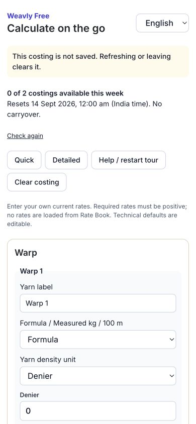
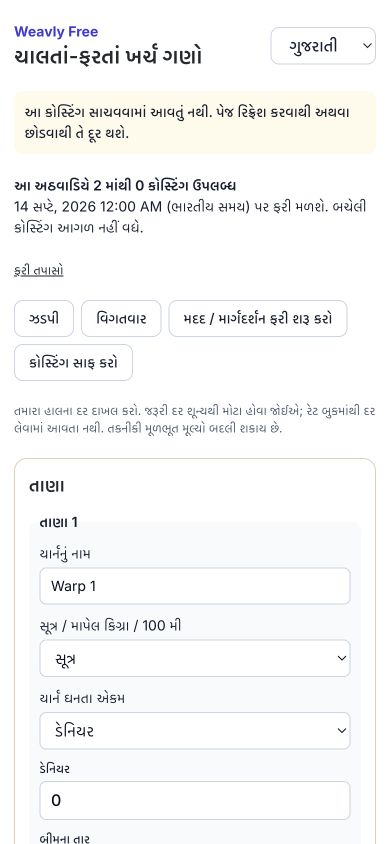
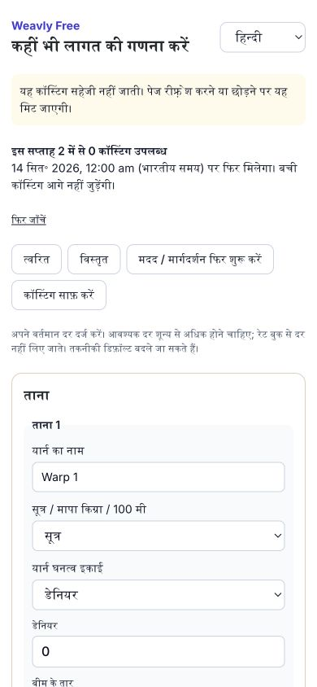

# Historical evidence — superseded product contract

> The weekly allowance documented here has been superseded. The current policy is two costings per Asia/Kolkata calendar month, resetting on the first at 00:00, as implemented by the monthly allowance migration.

The report below describes the initial implementation before the user clarified saved costings, exports, and reuse of the actual Lite estimator UI. Its no-storage/no-export statements and screenshots are obsolete. See EVIDENCE.md for current acceptance evidence.

# Weavly Free — consolidated sprint evidence

**Release status: BLOCKED for production/beta enablement.** The application implementation and local integration are complete; human acceptance, live gateway/device/performance evidence and production approval remain open. No production migrations, flag changes, charges or deployment were performed. Baseline commit: `89a19d5413650c37ecd810b495a2b89adea70e92`.

## Implemented capability matrix

| Capability | Free | Lite | Base |
|---|---|---|---|
| Account/settings | Required account; name, reset-password route, logout, confirmed deletion | Preserved | Preserved |
| Costing | Full manual inputs and authoritative on-screen breakdown, explicit weekly meter | Existing live costing workflow | Same costing workflow |
| Rates | Manual current-costing rates only | Existing Rate Book | Existing Rate Book |
| Qualities, saved costings, history | Denied | Existing workflow | Existing workflow |
| App export/PDF/share | Denied | Existing workflow | Existing workflow |
| Production | Denied | Denied | Existing workflow |
| Tour | Fixed sample; English/Gujarati/Hindi; skip/restart | Existing paid tour unchanged | Existing paid tour unchanged |

Free is an explicit grant, never an interpretation of missing billing. The original organization owner's Auth UUID is the immutable quota subject. Organization grants reference that subject; changing membership/workspace cannot create another allowance. Verification uses the existing trusted Auth-confirmed timestamp. Existing owner signup auto-confirms email; this is **not** evidence that the user completed an email challenge. Private beta enrollment additionally requires the server email allowlist. Pending, suspended, revoked and expired paid identities fail closed. Existing paid/legacy/trial lifecycle resolution runs first; expired paid users are not converted to Free.

## Counting and content policy

Two successful explicit costings per Monday 00:00 Asia/Kolkata week, no carryover. Typing, validation failure, presentation/language changes and the fixed sample cost zero. Changed effective inputs require another explicit submission. Counter/receipt commit precedes the response. A keyed canonical input binding and signed account/engine/request identity prevent changed-input or cross-account replay. Retries reuse the same identity, debit once, and retain the original week across reset. Proposed receipt lifetime is 30 days. Active-window allowance is frozen. Database time controls windows; browser time cannot replenish them.

No Free specifications, names, rates, margins or results are saved. Request identities and content stay in component memory. API responses use no-store; no autosave, persisted query, rate-prefill or offline queue is mounted. Raw request bodies are removed from Sentry events, Free events/transactions/log breadcrumbs are excluded, and Free replay content is blocked. Metadata-only events distinguish server calculation completion, client result view, fixed tour, quota hit and verified captured paid activation. Staff/test cohorts default excluded. Receipt retention is 30 days; proposed events/usage retention is separately 90 days. The prepared retention job is inactive.

## Changed implementation

- `lib/subscription-access.ts`, `lib/subscription.ts`, `lib/auth.ts`, owner layout, auth/onboarding/signup/proxy: explicit grant resolution, paid-compatible capability guards and private beta routing.
- `lib/free-account.ts`, `free-tier-policy.ts`, `free-request-identity.ts`, `free-estimator-input.ts`, `free-estimator-defaults.ts`, `free-service.ts`, `free-http.ts`: provisioning, trusted time, strict validation, shared engine, HMAC retry identity and commit-before-response.
- `app/free/{page,FreeClient,FreeInputs}.tsx`, `app/api/free/{status,calculate,events,account}/route.ts`, `lib/i18n/free-tier.ts`: memory-only UI, full manual costing, three-language sample, metadata events, account controls, in-page existing checkout and explicit post-upgrade save.
- `instrumentation-client.ts`, `instrumentation.ts`, `lib/sentry-redaction.ts`, `lib/free-telemetry.ts`, `next.config.ts`, `lib/free-browser-cache.ts`, `worker/index.ts`: Free telemetry exclusion, no-store responses and removal of legacy unscoped protected caches.
- Account deletion opts into Free account access while retaining its existing confirmation/provider checks.
- Four Free feature test files plus the browser-cache test and local QA scripts in `scripts/qa/free-tier-*.mjs`. Temporary browser-storage instrumentation was removed from the product.

Migrations, in order:

1. `20260908182417_free_tier_foundation.sql`: metadata tables, disabled flags, subject-scoped atomic debit/receipts.
2. `20260908190537_free_tier_runtime.sql`: idempotent provisioning; restrictive business and Storage RLS; Data API pre-request guard; content-free events; support/cohort views; inactive retention schedule; account-deletion cascades.
3. `20260908195000_free_upgrade_first_saved_quality.sql`: preserve paid yarn synchronization while falling back to the existing 90-day review interval when a newly upgraded owner has no factory profile. The real browser save exposed and verified this fix.

The cancellation entitlement review also distinguishes unpaid cancelled/failed checkout attempts from established paid history. It preserves the original Free grant after cancellation without converting expired paid accounts.

## Commands and executed results

| Check | Actual result | Evidence |
|---|---|---|
| Baseline full unit suite | 218 files; 1,448 passed, 1 skipped | `baseline-unit.log` |
| Baseline repository lint | 2 errors, 9 warnings in existing code | `baseline-lint.log` |
| Foundation identity/policy tests | 10 passed | `foundation-unit.log` |
| Isolated PostgreSQL foundation | 8 groups passed; 20 distinct concurrent requests with one left yield one success; 10 identical initial requests yield one debit; rollback and original-week replay | `database-foundation.log` |
| Input/engine/identity/privacy | 18 passed | `runtime-input-tests.log` |
| Service and selected auth/billing regressions | 30 passed | `runtime-service-billing-tests.log` |
| Runtime PostgreSQL | 5 groups passed: provisioning retry, authenticated guards, paid access/expiry, cohort boundaries, pause/deletion | `runtime-sql-tests.log` |
| `supabase db reset --local --workdir /tmp/weavly-free-sprint` | Clean full repository migration replay including foundation/runtime and Storage schema; third first-save migration applied afterward | `runtime-local-migration-replay.log` |
| Real Auth + PostgREST | Free Rate Book/qualities/saves/private RPC and profile reparenting denied even with a planted paid rate | `runtime-auth-data-api-tests.log` |
| Real Next APIs | Guest 401; invalid input no charge; first/second success; third denied without result; replay once; changed-input conflict; arbitrary demo flag rejected; no-store | `runtime-next-api-tests.log` |
| Full `vitest run --maxWorkers=2 --testTimeout=30000` | 220 files passed, 2 failed; 1,470 tests passed, 2 source assertions failed, 1 skipped | `runtime-full-suite.log` |
| Corrected full-run failures | Both stale source expectations resolved; 6 files / 32 tests passed, including account deletion/referral | `runtime-final-focused-tests.log` |
| Cancellation regression | 2 files / 12 tests passed; unpaid cancelled checkout retains Free, captured/established paid history does not fall back | `runtime-cancellation-tests.log` |
| Latest Free + auth-boundary regressions | 6 files / 33 tests passed | `runtime-last-focused-tests.log` |
| Synthetic local billing transaction | Wrong amount/currency/account rejected; captured activation once; callback replay deduplicated; one paid event; no automatic save | `runtime-local-upgrade.log` |
| Full-schema Storage/retention/explicit save | Free read/write denied despite permissive test policy; exactly one explicit saved costing; correct review interval; expired receipts pruned; schedule inactive; test transaction rolled back | `runtime-storage-retention-save.log` |
| Final optimized production build | Exit 0, webpack and PWA worker compiled, TypeScript passed, 53 static pages generated; local production Free screen loaded without captured browser errors | `runtime-production-build.log` |
| Production cancellation API | Active Free and unchanged exhausted quota after a synthetic unpaid cancelled order; fixture order removed | `runtime-local-cancellation.log` |
| Final `tsc --noEmit` and changed-file ESLint | Both exit 0 | `runtime-final-typecheck.log`, `runtime-final-lint.log` |

The complete regression run is **not** represented as an all-green run: its two failed source assertions were fixed and rerun with relevant tests. Earlier foundation runs hit unrelated payroll timeouts under Docker memory pressure; those raw logs and the successful isolated diagnostic remain in the evidence directory. Existing repository-wide lint failures were not silently removed.

The full local stack needed a task-local bootstrap restoring historical public default privileges before the old 2024 migrations, because the current Supabase image no longer initializes those defaults. That bootstrap exists only under `/tmp/weavly-free-sprint`, is not a shipped migration, and later repository hardening still applies. Cron launch is disabled locally to avoid historical notification jobs. App scripts explicitly blank external credentials, then inject only disposable localhost keys. Local generated keys and Auth fixtures are not included in evidence.

## Browser evidence

Observed in the in-app Chromium browser against localhost:3100:

- Manual formula fixture: 100D/4,000 ends warp at ₹200/kg; 150D/60 picks/150cm weft at ₹230/kg; weaving ₹0.16/pick; overhead ₹2/m; margin 20%; quantity 1,000m. Result **₹34.07/m production**, **₹42.59/m selling**; agrees with the existing authoritative engine.
- Typing consumed no allowance; first and second completions decremented it; the second result remained visible at zero and Calculate disabled. A scoped disposable quota fixture was reset after a development HMR change solely to start the separate upgrade scenario; this is not an application quota-reset feature.
- Quick/Detailed and en→gu→hi changes retained inputs and result without debit. Editing a rate marked the old result stale; restoring it removed the mismatch. The fixed tour displayed ₹55.91/m from the existing fixture without debit; arbitrary demo requests were rejected by the API.
- A complete input sentinel had **zero matches** in localStorage, sessionStorage, all IndexedDB stores and cached response bodies before upgrade. The probe initially searched its own literal prefix in compiled JavaScript; switching to the full live-input value eliminated that instrumentation false positive. The read-only probe was removed afterward.
- Old service-worker caches contained historical protected responses from an older app. Free entry now retires those unscoped page/API caches and Supabase cross-origin entries; the recheck found **zero protected cached paths**. Static assets and principal-scoped paid drafts remain. Free resource observations showed only status/events/calculate and Free page traffic, with no Rate Book/prefill fetch.
- Verified local Lite activation retained the open form/result, with zero saved costings before explicit Save. Explicit Save created one costing and disabled duplicate submission. First attempt exposed the missing-profile review-interval bug; the third migration fixed it, and the same save request then succeeded.
- Logout reached login. Signing into a different Free fixture showed blank inputs, its own exhausted allowance, and no previous account's costing. A fresh second tab also showed blank inputs and the same zero allowance. A clean reload preserved that quota. Dirty-page reload/discard automation could not reliably expose the native confirmation; that specific confirmation/resume case remains a device/browser gate, not a claimed pass.
- 390×844 layout checked in all three languages without horizontal overflow. 640×450 reflow (200%-equivalent width, **not actual zoom**) inspected in Hindi. Tour Skip worked with Enter and focus returned to Help. Actual screen-reader, reduced-motion setting, 200% zoom and installed-PWA/mobile-resume checks remain open.
- Screenshots below capture the final local production-build Free screen with the exhausted allowance. They are actual browser artifacts, not design mockups.

| English | Gujarati | Hindi |
|---|---|---|
|  |  |  |

## Local closeout

All three disposable local rollout flags were set back to false and read back. The production test server and task-specific Supabase stack were stopped, with the local database volume preserved. No production services were changed. Local-only test fixtures are excluded from analytics and no signing keys or credentials were copied into the repository.

## Remaining gates and honest release status

**BLOCKED**, not beta-ready/public-ready. Complete native Gujarati/Hindi terminology and sample/domain review; five actual owner sessions including Gujarati/Hindi, with ≥90% critical-task completion and zero critical saved-data/price misunderstanding; live sandbox gateway success/cancel/failure/delayed callback journey; actual screen-reader/zoom/PWA lifecycle; deployed telemetry capture audit; LCP/CLS lab and p75 field INP observations. The deterministic local trusted activation test is not a real Razorpay charge or gateway browser test. Cold development compilation was slow and is not a performance-budget pass.

Public decisions still require approval: two per India-time Monday week, changed-input counting versus bounded corrections, no exports, 30-day receipts and separate 90-day analytical retention, and current Lite terms. Production migration and enablement use the established approval process. Configuration, support lookup, cohort denominators and non-destructive rollback are in `OPERATIONS.md`. No human sessions or conversion uplift are fabricated.

Owner-session protocol is ready for five real participants (at least one Gujarati and one Hindi speaker): sign up; skip/restart tour; enter one real costing; explain the result; state remaining allowance and reset; explain what survives refresh; find Lite and state first-year/renewal prices. Record each task as unassisted/pass, rescued, failed or misunderstood, using participant codes only and no costing content. All five sessions are currently **not run**. Collect native terminology corrections against `lib/i18n/free-tier.ts`, then rerun affected screenshots and tasks before enabling beta.

## Discovery and design map

| Boundary | Verified repository paths and findings |
|---|---|
| Authoritative formula | `lib/estimator.ts`: `calcFullTotals`, `buildCostingResult`, Decimal half-up rounding, `COSTING_CALCULATION_VERSION`; `lib/estimator-validation.ts` validates snapshot and result readiness |
| Paid screen | `app/(dashboard)/owner/estimator/EstimatorClient.tsx`: reducer, Quick/Detailed presentation, `useMemo(calcFullTotals(state))`, live mobile/sticky results, scenarios, drafts and exports. An unchanged Free mount would expose unmetered results. A separate Free data/presentation path must reuse this engine, never fork formulas. |
| Initial/background rates | Estimator `page.tsx` loads `getFactoryCostProfile`; `actions.ts` loads factory settings and deferred `getEstimatorSecondaryData` reads `cost_rate_book`. Owner `layout.tsx` also queries rate review metadata for its sidebar. Free must branch before these loads, including shell prefetch. |
| Saved content | Estimator actions operate on `estimator_templates`, `estimator_quotes`, `factory_cost_profile`; saved-costing snapshots/versioning and attestation include service-role writes. Hiding controls/RLS alone is insufficient for privileged actions. |
| Authentication | `lib/auth.ts`: `getCachedSession` checks Auth user, DB profile role/org, revocation. `requireRole` is role-level, not a costing entitlement check. `proxy.ts` uses verified routing claims and onboarding redirects. |
| Provisioning | `app/(auth)/actions/auth.ts`: `createOrganization`, `_createOwnerProfile`, then billing selection. It currently uses `auth.admin.createUser({email_confirm:true})`; do not claim a completed user email challenge. Signup requires phone validation but is not new phone OTP. |
| Commercial identity | Subscriptions reference `organizations.id`; profiles reference `org_id`; organizations carry `owner_id`. There is no discovered unique constraint limiting an owner to one organization. Proposed immutable subject is the original commercial owner's auth UUID, with multiple organization grants referencing that subject. Membership/workspace changes must never mint fresh allowance. Ownership transfers need explicit reviewed mapping, not automatic rebinding. |
| Entitlements | `lib/subscription-access.ts`, `lib/subscription.ts`, `components/billing/AccessGate.tsx`. Current Lite/Base/trial/premium access is resolved across rows. Paid Base history preserves Lite after expiry. Missing subscriptions remain `none`; Free must be an explicit grant. Unknown/error states must not become paid or Free automatically. |
| Data authorization | `supabase/migrations/20260710054420_estimator_production_readiness_hardening.sql`, `20260710110907_enforce_standalone_estimator_boundary.sql`, `20260831150000_lite_base_plan_restructure.sql`: costing/production policies and `org_has_subscription_tier`. The latter explicitly permits service-role access, so it cannot be reused as a service-role paid-plan resolver. |
| Billing | `lib/billing-constants.ts`, `lib/billing-activation.ts`, `lib/billing-lifecycle.ts`, `app/api/billing/create-order/route.ts`, `verify-payment/route.ts`, webhook paths. Repository catalog: Lite ₹2,999 first year / ₹1,499 renewal, totals including configured GST, 365-day access. These are code observations, not confirmation of current deployed commercial approval. No prices changed. |
| Localization/tour | `lib/i18n/context.tsx`, `lib/i18n/locales/*`, `lib/i18n/cost-estimate-tutorial.ts`, `components/estimator/CostEstimateTutorial.tsx`. en/gu/hi and saved language preference exist. Current tour discusses paid saved workflows/live results; it cannot be relabeled Free unchanged. |
| Analytics | `lib/plan-analytics.ts`, `app/api/analytics/plan-events/route.ts`, plan-event tables. Existing event names/properties need explicit content-free Free events and server-success versus client-view separation. |

## Persistence and telemetry inventory

| Mechanism | Current evidence | Free requirement |
|---|---|---|
| localStorage estimator drafts | `hooks/useAutosave.ts`, `lib/estimator-drafts.ts`; debounced writes, immediate save, restoration and cross-tab reconciliation | Never mount these content-writing hooks on Free |
| Browser preferences | Width unit and guidance dismissal in EstimatorClient; locale in i18n context | Account preferences allowed; input/rate/request/result storage prohibited |
| Persisted query cache | `components/query-provider.tsx`; scoped storage used by settings/supervisor, memory variant also available | Inspect actual Free provider tree and avoid durable business queries |
| IndexedDB/offline | `lib/db.ts` (Dexie), `components/offline-sync-provider.tsx`, `hooks/use-offline-sync.ts` | Free must not enqueue costing operations |
| Service worker | `next.config.ts`: protected RSC/API/document/same-origin GET use NetworkOnly/no-store; static assets CacheFirst | Reuse policy; verify browser caches after actual Free requests |
| Exports | `lib/estimator-export.ts`, PDF generators and client export controls | No app export/share/download for Free |
| Sentry | `instrumentation-client.ts`: replay-on-error sampling 0.1, input/text masking, logs enabled. `lib/sentry-redaction.ts` redacts PII patterns but is not a costing-content allowlist | Exclude Free form/replay and raw request/response/exception bodies; masking alone does not establish no persistence |

This inventory guided the implementation. Executed browser and server checks are reported below; live Sentry delivery and physical-device behavior remain separate gates.
